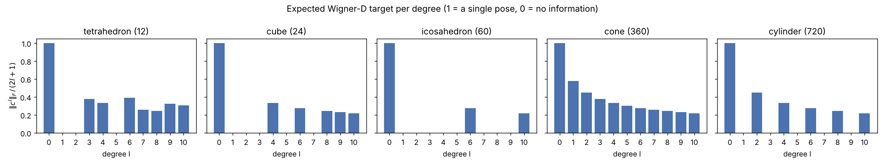
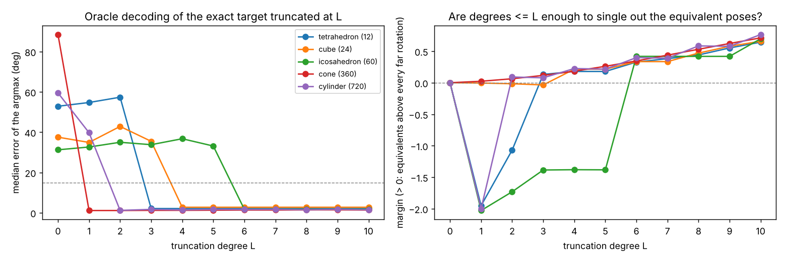

# Wigner-D spectrum of the SYMSOL I targets

Question: which Wigner degrees l does each SYMSOL shape's pose distribution need? Hypotheses: degrees L <= 2 are enough
for the cone and the cylinder, L <= 3 for the tetrahedron.

`spectrum.py` (run from `pose3d/`: `python -m probes.symsol_wigner_spectrum.spectrum --rotations <symsol>/test/rotations.npz`)
builds the Wigner-D regression target of `models/wignerd.py` (`flat_wigner`: the blocks sqrt(2l+1) D^l(R), Euler angles
as in `WignerD.target`) for every equivalent pose R* g of a test view (g in the shape's symmetry group G, |G| poses
listed by SYMSOL) and averages them: c^l = (1/|G|) sum_g sqrt(2l+1) D^l(R* g) is the minimiser of the squared regression
loss when the label is a random equivalent, i.e. what the head should predict. 30 test views per shape, l <= 10.

* **Magnitude** `|c^l|_F / (2l+1)`: 1 for a single pose, 0 when degree l carries no information about the pose. For a
  finite group it equals sqrt(m_l / (2l+1)), m_l = number of G-invariant directions in the degree-l irrep (checked: tet
  l = 3 gives 0.378 = sqrt(1/7), l = 6 gives 0.392 = sqrt(2/13)); it is the same for every view.
* **Oracle decoding**: the exact target truncated at degree L, f_L(R) = sum_{l<=L} <c^l, sqrt(2l+1) D^l(R)>, decoded as
  the Wigner-D head does, by the argmax over an SO(3) HEALPix grid (level 3, 36,864 rotations, 7.5 deg); error = angle
  to the nearest equivalent pose. **Margin** = (min over equivalents of f_L - max of f_L over grid rotations more than
  15 deg from every equivalent) / (max f_L - mean f_L): > 0 means degrees <= L single out the whole equivalent set at
  15 deg resolution.

## Result

Degrees with non-zero magnitude (first one in bold):

| shape | \|G\| | non-zero degrees l <= 10 | smallest L with argmax error < 15 deg on every view | margin at that L (min over views) |
|---|---|---|---|---|
| tetrahedron | 12 | **3**, 4, 6, 7, 8, 9, 10 | **3** (median 2.1 deg) | +0.13 |
| cube | 24 | **4**, 6, 8, 9, 10 | **4** (2.7 deg) | +0.21 |
| icosahedron | 60 | **6**, 10 | **6** (1.7 deg) | +0.42 |
| cone | 360 | every l, **1** | **1** (1.1 deg) | +0.02 |
| cylinder | 720 | even l only, **2** | **2** (1.2 deg) | +0.09 |

(The argmax errors of 1–3 deg are the 7.5 deg grid's resolution; the cylinder's odd degrees are 0.002, not 0, because
SYMSOL lists 720 discrete equivalents.)

* **Both hypotheses hold, in a sharper form.** The cone needs only l <= 1 (the l = 1 block is its axis), the cylinder
  l <= 2 (its flip symmetry removes every odd degree, so l = 1 carries nothing), the tetrahedron l <= 3 (l = 1, 2 are
  exactly zero: with L <= 2 the tetrahedron's target is the uniform distribution). The cube needs l = 4 and the
  icosahedron l = 6, below which their targets are exactly uniform.
* **At the threshold the peaks are wide.** The margins at the first sufficient L are small (cone +0.02 at L = 1,
  tetrahedron +0.13 at L = 3) and grow with every further non-zero degree: the first degree identifies the poses, more
  degrees sharpen the peaks.
* This is a statement about the target distributions (information), not about what a network learns. It matches the
  runs in `reports/symsol_stf/README.md`, section 7: STF L = 3 learns the cone and cylinder but not the tetrahedron in
  40 epochs; STF L = 6 for 100 epochs resolves the tetrahedron, partly the cube, not the icosahedron (whose only degree
  below 10 is l = 6); `harm6` (pose harmonics l <= 6) + NC resolves all five.
