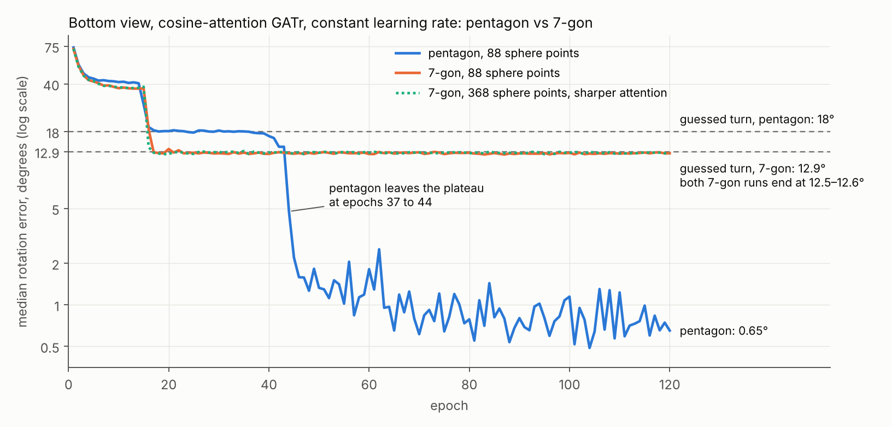
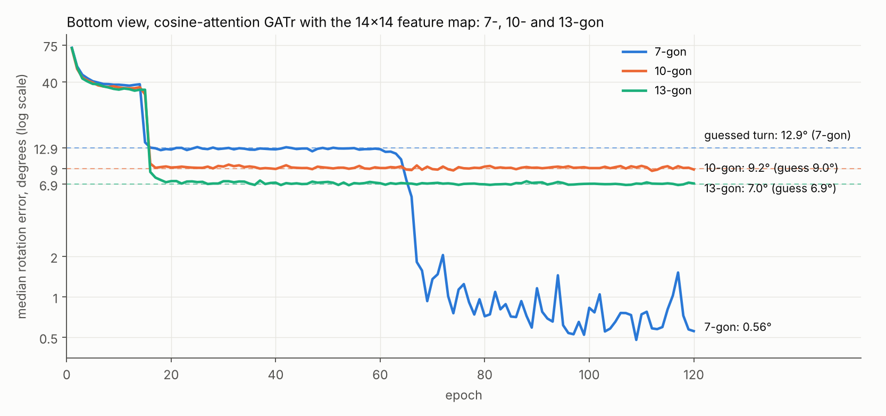
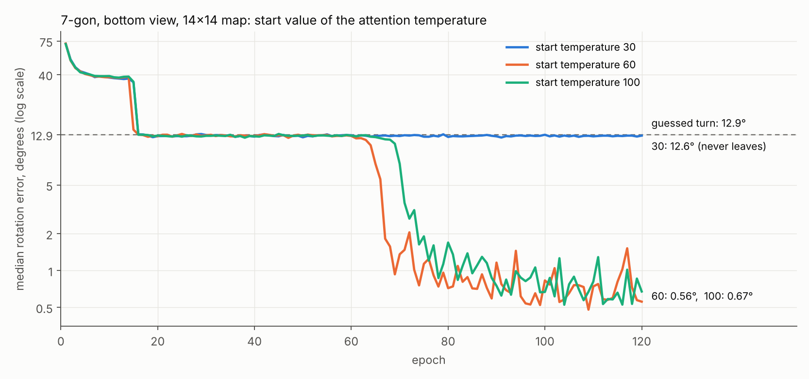
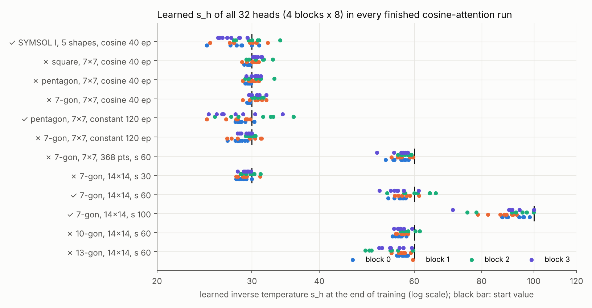
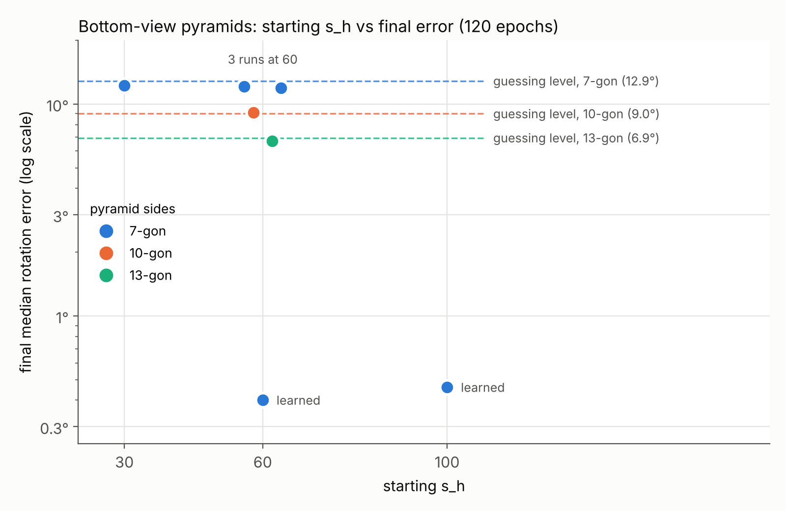
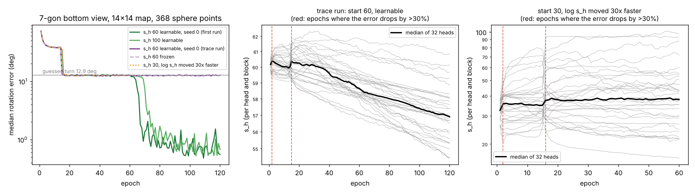
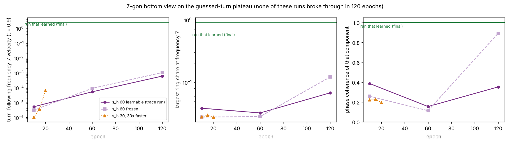
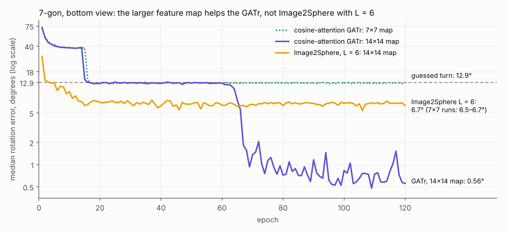

# Why the cosine-attention GATr guesses the turn of bottom-view pyramids

Investigation, 2026-11-16. Scripts and numbers: `probes/cosdir_interp/` (`bottom_diag.py`, `ft.py`, `snr.py`).
Background: `reports/cosdir_mechanism.md` (how this model reaches high rotation degrees) and
`reports/symmetry_spectrum.md` on branch `claude/symsol-symsol2-differences-2dukos` (SYMSOL-CHILE).

## The task and the failure

* **Bottom view** (SYMSOL-CHILE, `--view bottom`): a pyramid with a regular `n`-sided base, seen from straight
  below. The only thing that varies is the turn `theta` about the optical axis, so the pose is `R = Rz(theta)`,
  and turns that differ by `360/n` degrees are the same image.
* **Model**: the cosine-direction attention GATr of `reports/cosdir_mechanism.md` (a flow model: a ResNet-50 turns
  the image into 89 tokens on the sphere, a GATr predicts the velocity of the pose), trained for 40 epochs with a
  cosine learning-rate schedule, one run per `n` (Kaggle kernels `bottom{4,5,7,10,13}-gatr-spherecloud-cosdir-h8-t4x2`).
* **Result of those runs**: the median rotation error ends at 22.6, 18, 13, 9 and 7 degrees for `n` = 4, 5, 7, 10,
  13. That is `90/n` degrees, the error of a model that knows the pose is a turn about the axis and guesses the
  turn.

All five runs have the same curve: a first plateau at 35 to 45 degrees for 17 to 18 epochs, one drop to `90/n`
between epochs 17 and 19, then nothing.

| n | median error by epoch (every 3rd) |
|---|---|
| 4 | 75 48 46 44 44 44 **24** 23 23 23 23 23 23 23 |
| 5 | 73 45 43 42 41 40 **18** 18 18 18 18 18 18 18 |
| 7 | 72 43 38 38 37 37 **15** 13 13 13 13 13 13 13 |
| 10 | 71 41 37 36 36 36 **17** 9 9 9 9 9 9 9 |
| 13 | 73 41 37 35 35 34 **8** 7 7 7 7 7 7 7 |

## Findings (square, `n` = 4, final checkpoint of the run, 1,000 test images)

**1. The image encoder knows the turn.** A linear read-out of `(cos 4 theta, sin 4 theta)` from the 89 x 64 scalar
features that the GATr receives reaches a held-out R² of 1.00 (0.99 even from their mean over tokens; 1.00 from
the ResNet map).

**2. The turn is on the sphere grid.** On the rings of 16 grid points around the optical axis, 15 to 25 % of the
signal's variance along the ring is at azimuthal frequency 4, and its phase follows the turn (coherence 0.76 to
0.80, where 1 is perfect). The rings of 4 and 8 points near the axis cannot hold frequency 4, as predicted, but
the outer rings can.

**3. The velocity already contains the right component, about 100 times too small.** For a fixed image, the
predicted velocity about the axis as a function of the pose's turn is a clean wave of frequency 4 whose phase
matches the true turn (aligned part 0.0055 of an amplitude 0.0055 at flow time 0.5; 0.0205 of 0.0208 at 0.9). The
correct field has amplitude of order 1.

**4. How far the model is from the best possible field.** With `v*` the exact velocity that flow matching
converges to (the average of the directions to the `n` equivalent poses, weighted by how likely each is given the
current pose; `vstar` in `ft.py`), and "blind" the same for a model that never sees the image:

| mean squared distance | value |
|---|---|
| blind field to `v*` (what knowing the turn is worth) | 0.789 |
| trained model to `v*` | 0.747 |
| trained model to the blind field | 0.078 |

The training loss at the plateau is 2.33, so the turn is worth a third of it, and the model has collected 5 % of
that. It is the blind field.

**5. The architecture can learn it, and so can plain flow matching, given more steps.** Training only the GATr
field from the final checkpoint, on frozen image tokens, AdamW at the run's full learning rate 1.41e-4, batch 64,
one (noise, time) sample per image (so one pass over the 4,500 images is 70 steps):

| passes | exact velocity as the target | standard flow matching (control) |
|---|---|---|
| 0 | 24.0 | 24.0 |
| 3 | 24.1 | 23.9 |
| 5 | 22.3 | 22.8 |
| 6 | 20.1 | 20.8 |
| 7 | 15.4 | 19.1 |
| 8 | 8.0 | 12.1 |
| 9 | 4.2 | 5.3 |
| 10 | 2.4 | 3.4 |
| 11 | 2.6 | 3.7 |
| 14 | 1.8 | (stopped at 11) |

(median error in degrees to the nearest equivalent pose, 200 test images, one sample each, 20 flow steps). Both
leave the plateau after about 350 steps and resolve the turn after about 700. The unchanged model, objective and
data therefore do learn the square's turn.

**6. The noise of the flow-matching target is not the obstacle.** At the plateau checkpoint the sampled target
adds a gradient noise of norm 8.7 per batch of 64, on top of a batch-to-batch scatter of 16 that the exact target
has as well; and the control in 5 follows the exact-target run with a delay of about one pass.

## Pentagon and 7-gon: the frozen-encoder test does not move them

The continuation test of finding 5 was repeated on the final checkpoints of the pentagon (`n` = 5) and 7-gon
(`n` = 7) runs, one thread or two per run, so 3 to 5 minutes per pass. Median error in degrees after the last pass
(start: 19.0 and 13.5; a guessed turn gives 18 and 12.9):

| what is trained, target, learning rate | passes | pentagon | 7-gon |
|---|---|---|---|
| field, standard flow matching, 1.41e-4 | 11 | 19.7 | 12.9 |
| field, standard flow matching, 7.07e-6 (the rate the runs ended with) | 8 | 19.4 | 13.0 |
| field + projection onto the sphere (1x1 convolution and lift, on cached ResNet maps), standard, 1.41e-4 | 10 | 19.8 | 12.8 |
| field + projection, exact velocity `v*` as the target, 1.41e-4 | 9 | 18.7 | 13.8 |

Nothing leaves the plateau, and the distance to the exact field does not shrink (pentagon 0.62 to 0.67, 7-gon 0.44
to 0.48). The square, under the first row's setting, was at 12 degrees after 8 passes and 3.4 after 10. (The end-to-end run in the next section shows that this test was too
restrictive for the pentagon.)

What differs, measured on the two checkpoints with `bottom_diag.py` (1,000 test images each):

| | square | pentagon | 7-gon |
|---|---|---|---|
| turn readable from the tokens, linear R² | 1.00 | 1.00 | 1.00 |
| share of the signal along a 16-point ring at azimuthal frequency `n` | 0.15 to 0.25 | 0.01 to 0.04 | 0.002 to 0.012 |
| coherence of that component's phase with the turn (1 = perfect) | 0.76 to 0.80 | 0.34 to 0.41 | 0.05 to 0.10 |

In all three cases the encoder knows the turn, but only for the square is it laid out on the sphere as a pattern
with `n` lobes around the optical axis that turns with the object. The attention windows of
`reports/cosdir_mechanism.md` read exactly such a pattern: the pose token looks at the sphere where its own body
direction points, so the value it reads depends on the pose's turn only if the features vary along the ring. For
the pentagon and 7-gon the turn is in the tokens as a code that is nearly the same at every ring position, which
the pose token can read but cannot compare with its own turn at frequency `n`.

A likely reason the square is special, not tested: the 7x7 feature map, the lift and the HEALPix grid all have
four-fold symmetry, so a four-lobed pattern fits them, while a five- or seven-lobed pattern does not.

## Pentagon, end to end with a constant learning rate: it learns the turn

Kaggle kernel `saudic/bottom5-gatr-cosdir-h8-constlr-e120-t4x2` (2026-11-16): the original pentagon run with two
changes, a constant learning rate (`--lr_schedule step --lr_step_gamma 1.0`) and 120 epochs instead of 40. Same
code snapshot, 2xT4, batch 64, seed 0, ResNet trainable; 72 s per epoch.

| epochs | median error, degrees |
|---|---|
| 1 to 14 | 74 down to 40 (first plateau) |
| 15, 16 | 28, 19.5 |
| 17 to 36 | 18 (guessed turn: 20 epochs) |
| 37 to 43 | 17.7, 17.6, 17.5, 16.7, 16.2, 14.0, 14.0 |
| 44, 45, 46 | 4.8, 2.2, 1.6 |
| 47 to 120 | 0.5 to 2.5, about 0.7 at the end (0.65 at epoch 120) |

Final evaluation (32 samples per image, 1,000 test views): median error 0.50 degrees, acc@15 1.0, log-likelihood
14.28 (uniform: -2.29).

The second plateau lasts about 27 epochs (1,900 steps of batch 512); the 40-epoch run had 22 epochs left when it
reached it, at a decaying rate. So the schedule explains the pentagon too, and the CPU test above was misleading
for it: it froze the ResNet and stopped after about 800 steps of batch 64. Which of the two (frozen ResNet, short
budget) made the difference is not known.

## 7-gon, end to end with a constant learning rate: it stays on the plateau

Kaggle kernel `cheesewaffler/bottom7-gatr-cosdir-h8-constlr-e120-t4x2` (2026-11-16): the same two changes on the
original 7-gon run.

| epochs | median error, degrees |
|---|---|
| 1 to 15 | 72 down to 37 (first plateau) |
| 16 | 18.7 |
| 17 to 120 | 12.3 to 13.5 (guessed turn: 12.9); mean 12.7 over epochs 17 to 40, 12.6 over 41 to 80, 12.5 over 81 to 120 |

Final evaluation (32 samples per image, 1,000 test views): median error 11.75 degrees, acc@15 0.623, log-likelihood
7.84. The model stays on the guessed-turn plateau for 104 epochs, against 27 for the pentagon; the mean drifts down
by about 0.1 degrees over the run. So within 120 epochs the schedule does not explain the 7-gon. This is the case
that the grid argument singled out: 88 hemisphere points give at most 16 per ring around the optical axis, the
bare minimum for a 7-fold pattern, and the attention windows pass degree 7 at 6 to 32 % of its amplitude.

## 7-gon on a denser sphere grid with sharper attention: no change

Kaggle kernel `cheesewaffler/bottom7-gatr-cosdir-nside8-s60-constlr-e120-t4x2` (2026-11-17): the constant-rate
7-gon run with `--dircloud_nside 8` (368 hemisphere points, up to 32 per ring around the optical axis, instead of
88 with at most 16) and the cosine attention started at inverse temperature 60 instead of 30
(`notebooks/bottom7-gatr-cosdir-nside8-runner.ipynb`; 180 s per epoch on 2xT4).

| | 88 points, temperature 30 | 368 points, temperature 60 |
|---|---|---|
| first plateau ends | epoch 16 | epoch 16 |
| median error, epochs 17 to 120 | 12.3 to 13.5 | 12.4 to 13.1 |
| mean over epochs 17-40 / 41-80 / 81-120 | 12.66 / 12.63 / 12.53 | 12.70 / 12.70 / 12.66 |

Final evaluation (32 samples per image): median error 12.04 degrees, acc@15 0.614, log-likelihood 12.92 (88 points:
11.75 degrees, 0.623, 7.84). The log-likelihood is much higher although the turn is still guessed: it rewards how
tightly the poses are placed on the ring of turns about the axis, which the denser grid sharpens, not the turn.

The two curves coincide (figure above). So the number of points per ring and the width of the attention windows
are not, alone, what keeps the 7-gon at the guessed-turn level.

The next section tests the remaining suspect, the 7x7 ResNet feature map, which the lift only interpolates onto
the sphere (a denser sphere grid adds no information).

## 7-gon with a 14x14 feature map: the turn is learned

Kaggle kernel `cheesewaffler/bottom7-gatr-cosdir-grid14-nside8-s60-e120-t4x2` (2026-11-17): the denser-grid run
above plus `--dircloud_grid 14`, which runs the ResNet's last stage at stride 1 with dilation 2 (pretrained weights
kept; output checked against torchvision's own dilated ResNet-50), so the sphere tokens are lifted from a 14x14 map
instead of 7x7 (`notebooks/bottom7-gatr-cosdir-grid14-nside8-runner.ipynb`; 189 s per epoch on 2xT4).

| epochs | median error, degrees |
|---|---|
| 1 to 14 | 72 down to 38 (first plateau) |
| 15 | 14.2 |
| 16 to 60 | 12.4 to 13.1 (guessed turn 12.9: 45 epochs) |
| 61 to 66 | 12.0, 12.1, 11.7, 10.6, 7.4, 5.6 |
| 67, 68 | 1.8, 1.6 |
| 69 to 120 | 0.5 to 2.1, mean 0.74 over the last 20 epochs (0.56 at epoch 120) |

Final evaluation (32 samples per image, 1,000 test views): median error 0.40 degrees, acc@15 0.999, log-likelihood
13.28. The run that differs only
in the map size stayed at 12.4 to 13.1 degrees for all 120 epochs, so the 7x7 feature map was a limit for the
7-gon. Whether the 14x14 map is enough without the denser sphere grid and sharper attention was not run. The
second plateau lasts 45 epochs here against 27 for the pentagon.

## 10-gon and 13-gon with the 14x14 map, and the start temperature on the 7-gon

Four more runs of the 14x14 setup (2026-11-19; 368 sphere points, constant rate, 120 epochs, about 192 s per epoch on
2xT4; notebooks from `notebooks/make_bottom_grid14_variant.py`). "Start temperature" is the value the cosine
attention's inverse temperature `s_h` begins at (it is learnable, and capped at 100 in the code).

| kernel | pyramid | start temperature | median error, epochs 17 to 120 | last 20 epochs: mean | guessed turn |
|---|---|---|---|---|---|
| `cheesewaffler/bottom10-gatr-cosdir-grid14-nside8-s60-e120-t4x2` | 10-gon | 60 | 8.7 to 9.7 | 9.18 | 9.0 |
| `saudic/bottom13-gatr-cosdir-grid14-nside8-s60-e120-t4x2` | 13-gon | 60 | 6.8 to 7.7 | 6.95 | 6.9 |
| `pepeschneyne/bottom7-gatr-cosdir-grid14-nside8-s30-e120-t4x2` | 7-gon | 30 | 12.2 to 13.0 | 12.58 | 12.9 |
| (the run of the section above) | 7-gon | 60 | plateau to epoch 60, then down | 0.74 | 12.9 |
| `pepeschneyne/bottom7-gatr-cosdir-grid14-nside8-s100-e120-t4x2` | 7-gon | 100 | plateau to epoch 65, then down | 0.75 | 12.9 |

**10-gon and 13-gon: not learned.** Both stay at their guessed-turn level for all 104 epochs after the first
plateau, with no trend. The setup that learns the 7-gon does not reach a 10- or 13-fold pattern in 120 epochs.

**Start temperature on the 7-gon.** With 60 the error first drops below 5 degrees at epoch 67, with 100 at epoch
71; both settle at the same level (final 32-sample evaluation 0.40 and 0.46 degrees, acc@15 0.999 and 1.0). With
30, the value of all earlier runs, the model never leaves the plateau (final evaluation 12.21 degrees, acc@15
0.625). So with the 14x14 map the sharper attention is needed too: 30 fails, 60 and 100 succeed about equally.
Together with the earlier runs, the 7-gon needs both changes: a 14x14 map with temperature 30 fails, and
temperature 60 with a 7x7 map fails. One seed per setting, so "30 never learns" means "not in 120 epochs, seed 0".
(Correction, 2026-11-20: two later start-60 runs did not break through in 120 epochs; both changes make the 7-gon
learnable, not reliably learned. See the s_h section below.)
The learned values of `s_h` are not printed in the log and were not read from the checkpoints.

Final evaluations (32 samples per image): 10-gon median error 9.11 degrees, acc@15 0.825, log-likelihood 14.71;
13-gon 6.68 degrees, acc@15 1.0, log-likelihood 13.172. The high log-likelihoods again reflect how tightly the poses sit
on the ring of turns, not knowledge of the turn (acc@15 is 1.0 for the 13-gon only because a guessed turn is never
more than 13.8 degrees off).

## Why the 10-gon and 13-gon are not learned: the attention windows are too wide

CPU analysis of the four finished 14x14 checkpoints (`probes/cosdir_interp/diag2.py`, 600 test images each;
`gap_vs_n.py`). Columns: R2 of a linear read-out of the turn (cos and sin of n times the turn) from the sphere tokens;
the largest share of a ring's variance at azimuthal frequency n, and that component's phase coherence with the turn
(1 = it turns exactly with the object); the turn-dependent part of the predicted velocity; the median concentration
kappa of the pose token's attention windows (fitted as in `reports/cosdir_mechanism.md`), and the amplitude
a_n = i_n(kappa) / i_0(kappa) with which a window of that width passes a degree-n signal.

| checkpoint | learned? | R2 | n-lobed share / coherence | velocity, frequency n | median kappa | a_n (median) |
|---|---|---|---|---|---|---|
| 7-gon, start temperature 60 | yes | 1.00 | 0.92 / 1.00 | 2.5 | 25.7 | a_7 = 0.33 |
| 7-gon, start temperature 30 | no | 1.00 | 0.05 / 0.29 | 0.0 | 10.8 | a_7 = 0.07 |
| 10-gon, start temperature 60 | no | 1.00 | 0.03 / 0.18 | 0.0 | 24.2 | a_10 = 0.10 |
| 13-gon, start temperature 60 | no | 1.00 | 0.01 / 0.05 | 0.0 | 26.7 | a_13 = 0.03 |

* Every model knows the turn (R2 1.00). Success coincides with the turn being laid out on the sphere as an n-lobed
  pattern that turns with the object, which is the form the attention windows can read; only the successful run has it.
* The learned temperatures stay at their start values (about 29 for a start of 30, 54 to 60 for 60), and kappa is
  about 0.37 to 0.48 times s_h. So the start value fixes the window width for the whole run.
* At start temperature 60 the 10-gon's windows pass degree 10 at 0.10 and the 13-gon's degree 13 at 0.03: less than
  the 0.07 at which the 7-gon with start temperature 30 failed. The plausible mechanism is the same plateau as before:
  the n-lobed pattern gets gradient only through what the windows pass, and the windows only matter once the pattern
  exists, so a small a_n makes the escape from the guessed-turn plateau very slow or impossible.
* What learning the turn is worth to the loss also falls with n (distance between the exact and the best blind field:
  0.79, 0.65, 0.46, 0.34, 0.27 for n = 4, 5, 7, 10, 13), a second, milder reason the larger pyramids are harder.

Prediction: to pass degree n as well as the successful 7-gon passed degree 7 (a = 0.33), the windows need kappa of
about 50 for the 10-gon and 83 for the 13-gon, that is start temperatures of about 110 and 185. The code caps s_h at
100. A window of kappa 83 is 6.3 degrees wide, finer than the 7.3-degree spacing of the 368-point sphere grid, so the
13-gon probably also needs the next grid density (nside 16). This is a hypothesis from one seed per setting; the
10-gon at start temperature about 110 is the direct test.

Scheduled for 2026-11-21 00:05 UTC (four 180-epoch runs, about 10.4 h each on 2xT4, cap on s_h raised to 1000): the
10-gon at start 120 and the 13-gon at start 200, and each with the 8 heads of every block started at log-spaced
temperatures from 30 to 250 (wide heads for the low degrees, sharp ones for degree n). nside 16 costs about 4x per
step (CPU timing), 25 h per run, so it was not scheduled. Smoke tests (3 epochs): `pepeschneyne/bottom13-s200-smoke-e3-t4x2`
and `pepeschneyne/bottom13-spread-smoke-e3-t4x2`, both finite, 199 to 203 s per epoch.

## The learned s_h in all finished runs

The learned inverse temperatures of all 32 heads (4 blocks x 8) at the end of every finished cosine-attention run
(`results/s_h_final_all_runs.json`, `results/s_h_final_vs_weight_decay.json`):

* **The average does not learn.** AdamW applies its default weight decay (0.01) to log s_h as to every parameter. That
  alone predicts the median s_h of every run within about 2 % (for example 57.2 against 57.0, 57.2, 56.7, 56.3 for the
  four runs started at 60), whether the run learned the turn or not. The gradient adds nothing systematic.
* **The heads spread apart in runs that learned.** The spread of log s_h across heads, after removing the decay, is
  0.053 to 0.091 in the four runs that learned (SYMSOL I, the pentagon, the 7-gon at start 60 and 100) and 0.025 to
  0.037 in the runs that did not (0.052 for the 13-gon). Some heads sharpen (up to 35.8 from 30, 65.7 from 60), others
  widen.
* **Bounded speed.** With one learning rate (1.41e-4) and about 70 steps per epoch, Adam can move log s_h by at most
  about 0.01 per epoch, so no head can change s_h by more than about 7 % during the 7 epochs of a breakthrough. A large
  jump at the breakthrough is impossible by construction; a small coordinated change is not.
* In the run started at 100 several heads end exactly at the cap (100).

## Summary of the s_h experiments

Final median rotation error (32-sample evaluation) of every 120-epoch bottom-view run with the 14x14 map and 368
sphere points, by starting s_h and number of pyramid sides. Dashed lines: the guessing level 90/n degrees, the error of
a model that knows everything but the turn. The 7-gon learned at 60 (one of three runs) and at 100; the 10- and 13-gon
were only run at 60. Not shown: the 60-epoch run with log s_h moving 30x faster (7-gon, start 30: 11.69 degrees).
Runs at 120 (10-gon) and 200 (13-gon), and with heads spread from 30 to 250, are scheduled for 2026-11-21.
Why the threshold moves with n: `figures/cosdir_s_h_scaling.png` (how much of degree n an attention window passes).

## s_h epoch by epoch on the 7-gon: not the cause of the breakthrough, and the breakthrough is not reliable

Three runs of the 14x14 setup on the 7-gon (2026-11-19/20; 368 sphere points, constant rate; runners from
`notebooks/make_sh_trace_variant.py`). A watcher thread in each notebook read the per-epoch resume checkpoint and
logged all 32 values of s_h (4 blocks x 8 heads) and, where s_h is learnable, Adam's first and second moments of
log s_h (m and v; |m| / sqrt(v) near 1 means a consistent gradient sign, near 0 noise). It also saved model
snapshots for CPU analysis.

| kernel | s_h | epochs | median error, last 20 epochs | final evaluation (32 samples) |
|---|---|---|---|---|
| `pepeschneyne/bottom7-shtrace-s60-learn-t4x2` ("trace") | starts at 60, learnable | 120 | 12.3 to 12.9 | 12.12, acc@15 0.609 |
| `saudabubin/bottom7-shtrace-s60-frozen-t4x2` ("frozen") | fixed at 60 | 120 | 12.4 to 12.9 | 11.91, acc@15 0.625 |
| `avgurpetrovich/bottom7-shtrace-s30-free30x-t4x2` ("fast") | starts at 30, log s_h moves 30x faster, cap 1000 | 60 | 12.3 to 13.1 | 11.69, acc@15 0.637 |

None of the three left the guessed-turn plateau (12.9 degrees).

* **The breakthrough is stochastic.** The trace run has the same configuration and seed as the first start-60 run of
  the 14x14 section, which broke through at epoch 61. The two error curves differ by about 1 % from epoch 1 on (GPU
  nondeterminism) and part at the plateau: one learns, the other does not in 120 epochs. Of the four 7-gon runs with
  the 14x14 map and start s_h of at least 60, two learned (start 60, start 100) and two did not (trace, frozen). The
  conclusion of the 14x14 section is corrected accordingly: the 14x14 map with start s_h 60 or more makes the 7-gon
  learnable, not reliably learned in 120 epochs.
* **s_h moves only at the first two transitions, and they do not need it.** The largest per-epoch changes of log s_h
  fall at epoch 2 (error 73 to 53 degrees) and epochs 14 to 16 (38 to 13 degrees, when the ring of possible poses is
  found), in the trace run (largest single change 0.025) and in the fast run (0.45 and 0.74: one head doubles). The
  frozen run makes the same transitions at the same epochs (15) with s_h fixed. Between them the trace run's median
  s_h falls smoothly from 60 to 57, as weight decay predicts, and Adam's |m| / sqrt(v) is 2.0 in the first epoch and
  0.11 to 0.16 afterwards: no consistent push.
* **The fast run spreads its heads but does not learn.** By epoch 16 its 32 values span 16 to 97 (median 38). Its
  windows are wider than at start 60 (median a_7 = 0.14 against 0.33), and the 60 epochs are short.

**What grows on the plateau.** The diagnostics of the 14x14 section (`probes/cosdir_interp/diag2.py`, 600 test
images) on the snapshots (`results/diag2_snap_*.json`, `results/plateau_growth.json`): the turn-following
frequency-7 part of the predicted velocity at t = 0.9 (zero for a model that guesses the turn), the largest share of a
ring's token variance at azimuthal frequency 7, its phase coherence with the turn, and the median window pass a_7.

| snapshot | velocity, turn-following frequency 7 | ring share at 7 | coherence | a_7 |
|---|---|---|---|---|
| frozen, epoch 10 | 3.1e-6 | 0.028 | 0.26 | 0.33 |
| frozen, epoch 60 | 9.1e-5 | 0.028 | 0.11 | 0.35 |
| frozen, epoch 120 | 1.1e-3 | 0.122 | 0.89 | 0.34 |
| trace, epoch 10 | 5.3e-6 | 0.038 | 0.39 | 0.32 |
| trace, epoch 60 | 5.4e-5 | 0.032 | 0.15 | 0.34 |
| trace, epoch 120 | 6.1e-4 | 0.068 | 0.35 | 0.30 |
| fast, epochs 10 / 15 / 20 / 60 | 1.1e-6 / 3.8e-6 / 6.5e-5 / 2.0e-5 | 0.03 to 0.04 | 0.2, at 60: 0.04 | 0.13 to 0.15 |
| run that learned, epoch 120 | 2.5 | 0.92 | 1.00 | 0.33 |

* The windows are as wide in the runs that stayed on the plateau as in the one that learned (a_7 0.30 to 0.35 against
  0.33), so window width does not separate them.
* The 7-lobed pattern is there and grows: in the frozen run the turn-following velocity rises about 10x every 60
  epochs, and by epoch 120 a ring carries 12 % of its variance at frequency 7, turning with the object (coherence
  0.89). It is still about 2,000x below the run that learned. In the fast run, with windows half as wide in degree 7, nothing grows: at epoch
  60 the turn-following velocity is lower than at epoch 20 and the pattern has no phase coherence (0.04).
* Plausible picture: the plateau is a saddle, and the n-lobed direction escapes it roughly exponentially from a tiny
  starting amplitude. The epoch of the breakthrough is then set by that amplitude and the growth rate, so runs that
  differ only by noise break through at different times, some after 120 epochs. This is a reading of three
  snapshots per run, not a measured growth law.

So the answer to "is the 7-gon's breakthrough connected with a jump in the learned s_h": no. s_h jumps at the earlier
transitions, a frozen s_h does not prevent them, and what precedes the breakthrough is the slow growth of the n-lobed
pattern at unchanged window width.

## Image2Sphere with L = 6 on the 7-gon: the constant rate changes nothing

Kaggle kernel `arynabiaroza/symsol-bottom7-i2s-l6-constlr-e120-l4` (2026-11-16): the 40-epoch run
`arynabiaroza/symsol-chile-bottom7-i2s-l6-l4` (Image2Sphere, spherical-harmonic degrees up to `L` = 6, so no degree-7
component) with a constant learning rate after its 5 warm-up epochs and 120 epochs. Same snapshot, 4xL4.

| | 40 epochs, cosine | 120 epochs, constant |
|---|---|---|
| median error, last 20 epochs | 5.7 to 6.7 | 5.6 to 7.0 |
| final evaluation, 32 samples: median error | 6.49 | 6.74 |
| acc@15 | 0.88 | 0.919 |
| log-likelihood | 4.52 | 4.11 |

Both runs reach 6 to 7 degrees by epoch 18 and stay there; 80 more epochs at the full rate move nothing. So for
this model the level is a limit of the model, not of the schedule, as its band limit predicts.

**The same scaling as for the GATr** (`cheesewaffler/bottom7-i2s-l6-grid14-proj3-constlr-e120-t4x2`, 2026-11-17;
`notebooks/bottom7-i2s-l6-grid14-runner.ipynb`): `--i2s_grid 14` (the ResNet map at 14x14, as above) and
`--i2s_proj_rec_level 3` (the map is projected onto 400 hemisphere points instead of upstream's 104), constant rate,
120 epochs, `L` = 6 unchanged; 2xT4 instead of 4xL4, same global batch 64; 55 s per epoch.

| | 7x7 map, 104 points | 14x14 map, 400 points |
|---|---|---|
| median error, epochs 21 to 120: mean | (6 to 7 throughout) | 6.66 |
| median error, last 20 epochs | 5.6 to 7.0 | 5.4 to 7.2 (mean 6.65) |
| epoch 120 | 6.8 | 6.25 |

No change: the level is the same 6 to 7 degrees, reached at the same epoch (about 15). The larger map that took the
cosine-attention GATr from 12.6 to 0.4 degrees does nothing for a model limited to degree 6. The kernel ended with an
error after training, in the final evaluation (this snapshot calls the flow models' likelihood on Image2Sphere:
`'I2SReal' object has no attribute 'condition'`), so there is no 32-sample evaluation or log-likelihood for this
run; the per-epoch errors are complete.

Note that this level is half the 12.9 degrees of a guessed turn. Why a degree-6 model does better than guessing on
the bottom view was not investigated. One untested explanation: it cannot represent seven equal peaks, but it can
put one broad peak on one of the seven equivalent poses.

## Conclusion

* **Square and pentagon**: a training-schedule failure. Learning proceeds in steps separated by plateaus. The
  first (the pose is a turn about the optical axis, which does not depend on the image) takes 14 to 18 epochs. The
  second plateau, at the guessed-turn level, takes hundreds to thousands of further steps at the full rate (about
  700 for the square with the encoder frozen, about 1,900 for the pentagon end to end), and the 40-epoch cosine
  schedule has lowered the rate to 60 % when that plateau starts and to 19 % by epoch 30.
* **7-gon**: learnable (0.40 degrees in the final evaluation) once the feature map is 14x14 AND the attention starts
  sharper (start temperature 60 or 100), but not reliably: two of four such runs broke through within 120 epochs (at
  epochs 61 to 72), two did not, including a run identical to a successful one up to GPU nondeterminism. Either change
  alone left it at the guessed-turn level in every run: 7x7 map with temperature 60, or 14x14 map with temperature 30.
  The learned s_h does not jump at the breakthrough. Open: whether it also needs the denser sphere grid (every 14x14
  run used 368 points).
* **10-gon and 13-gon**: not learned with the setup that learns the 7-gon; both stay at the guessed-turn level.
* **Image2Sphere with L = 6** stays at 6 to 7 degrees on the 7-gon under every change tried (constant rate, 120
  epochs, 14x14 map, denser projection): a limit of the model, as its band limit predicts.
* The difference between the square and the others in how the turn is laid out on the sphere (table above) is
  real for the 40-epoch checkpoints, but it is not an obstacle to learning: it probably describes a model that has
  not started the second step, not one that cannot take it.

## Limits

* Field-only training (plus the projection in two rows) with the ResNet frozen and a fresh optimiser, batch 64.
  The original runs train the ResNet too, with batch 512 (8 samples per image). A trainable ResNet might learn to
  produce the `n`-lobed pattern for the pentagon and 7-gon; that was not run, and 9 to 11 passes is a short budget.
* The pentagon and 7-gon diagnostics stopped before their velocity part; the ring and read-out numbers are complete.
* Why the first, image-independent step takes 17 epochs was not investigated. It costs half the budget in every
  run and looks like the cheaper thing to fix.
* A run with nearest coupling (each noise sample flows to its nearest equivalent pose) was started from the same
  checkpoint and had not left the plateau after 3 passes; it is not conclusive.

## Next experiments (GPU, need approval)

1. The square bottom-view run with a constant learning rate or 120 epochs, end to end. Expected: the turn resolves
   soon after the first drop.
2. The pentagon and 7-gon the same way, to see whether a trainable ResNet finds the `n`-lobed pattern by itself.
   If not: a denser sphere grid and feature map without four-fold structure (HEALPix nside 8; a 14x14 map).
3. Find out why the ring of possible poses takes 17 epochs (for instance: start from a checkpoint trained on
   another `n`; the first step should transfer).
