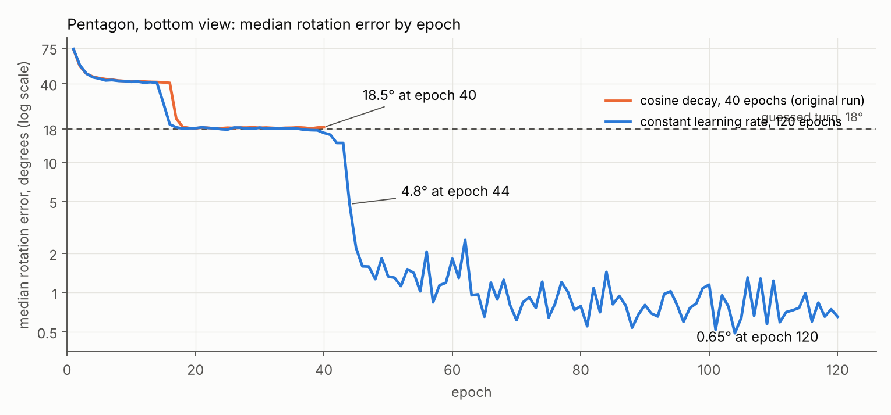

# Why the cosine-attention GATr guesses the turn of bottom-view pyramids

Investigation, 2026-11-16. Scripts and numbers: `probes/cosdir_interp/` (`bottom_diag.py`, `ft.py`, `snr.py`).
Background: `reports/cosdir_mechanism.md` (how this model reaches high rotation degrees) and
`reports/symmetry_spectrum.md` on branch `claude/symsol-symsol2-differences-2dukos` (SYMSOL-CHILE).

## The task and the failure

* **Bottom view** (SYMSOL-CHILE, `--view bottom`): a pyramid with a regular `n`-sided base, seen from straight
  below. The only thing that varies is the turn `theta` about the optical axis, so the pose is `R = Rz(theta)`,
  and turns that differ by `360/n` degrees are the same image.
* **Model**: the cosine-direction attention GATr of `reports/cosdir_mechanism.md` (a flow model: a ResNet-50 turns
  the image into 89 tokens on the sphere, a GATr predicts the velocity of the pose), trained for 40 epochs with a
  cosine learning-rate schedule, one run per `n` (Kaggle kernels `bottom{4,5,7,10,13}-gatr-spherecloud-cosdir-h8-t4x2`).
* **Result of those runs**: the median rotation error ends at 22.6, 18, 13, 9 and 7 degrees for `n` = 4, 5, 7, 10,
  13. That is `90/n` degrees, the error of a model that knows the pose is a turn about the axis and guesses the
  turn.

All five runs have the same curve: a first plateau at 35 to 45 degrees for 17 to 18 epochs, one drop to `90/n`
between epochs 17 and 19, then nothing.

| n | median error by epoch (every 3rd) |
|---|---|
| 4 | 75 48 46 44 44 44 **24** 23 23 23 23 23 23 23 |
| 5 | 73 45 43 42 41 40 **18** 18 18 18 18 18 18 18 |
| 7 | 72 43 38 38 37 37 **15** 13 13 13 13 13 13 13 |
| 10 | 71 41 37 36 36 36 **17** 9 9 9 9 9 9 9 |
| 13 | 73 41 37 35 35 34 **8** 7 7 7 7 7 7 7 |

## Findings (square, `n` = 4, final checkpoint of the run, 1,000 test images)

**1. The image encoder knows the turn.** A linear read-out of `(cos 4 theta, sin 4 theta)` from the 89 x 64 scalar
features that the GATr receives reaches a held-out R² of 1.00 (0.99 even from their mean over tokens; 1.00 from
the ResNet map).

**2. The turn is on the sphere grid.** On the rings of 16 grid points around the optical axis, 15 to 25 % of the
signal's variance along the ring is at azimuthal frequency 4, and its phase follows the turn (coherence 0.76 to
0.80, where 1 is perfect). The rings of 4 and 8 points near the axis cannot hold frequency 4, as predicted, but
the outer rings can.

**3. The velocity already contains the right component, about 100 times too small.** For a fixed image, the
predicted velocity about the axis as a function of the pose's turn is a clean wave of frequency 4 whose phase
matches the true turn (aligned part 0.0055 of an amplitude 0.0055 at flow time 0.5; 0.0205 of 0.0208 at 0.9). The
correct field has amplitude of order 1.

**4. How far the model is from the best possible field.** With `v*` the exact velocity that flow matching
converges to (the average of the directions to the `n` equivalent poses, weighted by how likely each is given the
current pose; `vstar` in `ft.py`), and "blind" the same for a model that never sees the image:

| mean squared distance | value |
|---|---|
| blind field to `v*` (what knowing the turn is worth) | 0.789 |
| trained model to `v*` | 0.747 |
| trained model to the blind field | 0.078 |

The training loss at the plateau is 2.33, so the turn is worth a third of it, and the model has collected 5 % of
that. It is the blind field.

**5. The architecture can learn it, and so can plain flow matching, given more steps.** Training only the GATr
field from the final checkpoint, on frozen image tokens, AdamW at the run's full learning rate 1.41e-4, batch 64,
one (noise, time) sample per image (so one pass over the 4,500 images is 70 steps):

| passes | exact velocity as the target | standard flow matching (control) |
|---|---|---|
| 0 | 24.0 | 24.0 |
| 3 | 24.1 | 23.9 |
| 5 | 22.3 | 22.8 |
| 6 | 20.1 | 20.8 |
| 7 | 15.4 | 19.1 |
| 8 | 8.0 | 12.1 |
| 9 | 4.2 | 5.3 |
| 10 | 2.4 | 3.4 |
| 11 | 2.6 | 3.7 |
| 14 | 1.8 | (stopped at 11) |

(median error in degrees to the nearest equivalent pose, 200 test images, one sample each, 20 flow steps). Both
leave the plateau after about 350 steps and resolve the turn after about 700. The unchanged model, objective and
data therefore do learn the square's turn.

**6. The noise of the flow-matching target is not the obstacle.** At the plateau checkpoint the sampled target
adds a gradient noise of norm 8.7 per batch of 64, on top of a batch-to-batch scatter of 16 that the exact target
has as well; and the control in 5 follows the exact-target run with a delay of about one pass.

## Pentagon and 7-gon: the frozen-encoder test does not move them

The continuation test of finding 5 was repeated on the final checkpoints of the pentagon (`n` = 5) and 7-gon
(`n` = 7) runs, one thread or two per run, so 3 to 5 minutes per pass. Median error in degrees after the last pass
(start: 19.0 and 13.5; a guessed turn gives 18 and 12.9):

| what is trained, target, learning rate | passes | pentagon | 7-gon |
|---|---|---|---|
| field, standard flow matching, 1.41e-4 | 11 | 19.7 | 12.9 |
| field, standard flow matching, 7.07e-6 (the rate the runs ended with) | 8 | 19.4 | 13.0 |
| field + projection onto the sphere (1x1 convolution and lift, on cached ResNet maps), standard, 1.41e-4 | 10 | 19.8 | 12.8 |
| field + projection, exact velocity `v*` as the target, 1.41e-4 | 9 | 18.7 | 13.8 |

Nothing leaves the plateau, and the distance to the exact field does not shrink (pentagon 0.62 to 0.67, 7-gon 0.44
to 0.48). The square, under the first row's setting, was at 12 degrees after 8 passes and 3.4 after 10. (The end-to-end run in the next section shows that this test was too
restrictive for the pentagon.)

What differs, measured on the two checkpoints with `bottom_diag.py` (1,000 test images each):

| | square | pentagon | 7-gon |
|---|---|---|---|
| turn readable from the tokens, linear R² | 1.00 | 1.00 | 1.00 |
| share of the signal along a 16-point ring at azimuthal frequency `n` | 0.15 to 0.25 | 0.01 to 0.04 | 0.002 to 0.012 |
| coherence of that component's phase with the turn (1 = perfect) | 0.76 to 0.80 | 0.34 to 0.41 | 0.05 to 0.10 |

In all three cases the encoder knows the turn, but only for the square is it laid out on the sphere as a pattern
with `n` lobes around the optical axis that turns with the object. The attention windows of
`reports/cosdir_mechanism.md` read exactly such a pattern: the pose token looks at the sphere where its own body
direction points, so the value it reads depends on the pose's turn only if the features vary along the ring. For
the pentagon and 7-gon the turn is in the tokens as a code that is nearly the same at every ring position, which
the pose token can read but cannot compare with its own turn at frequency `n`.

A likely reason the square is special, not tested: the 7x7 feature map, the lift and the HEALPix grid all have
four-fold symmetry, so a four-lobed pattern fits them, while a five- or seven-lobed pattern does not.

## Pentagon, end to end with a constant learning rate: it learns the turn

Kaggle kernel `saudic/bottom5-gatr-cosdir-h8-constlr-e120-t4x2` (2026-11-16): the original pentagon run with two
changes, a constant learning rate (`--lr_schedule step --lr_step_gamma 1.0`) and 120 epochs instead of 40. Same
code snapshot, 2xT4, batch 64, seed 0, ResNet trainable; 72 s per epoch.

| epochs | median error, degrees |
|---|---|
| 1 to 14 | 74 down to 40 (first plateau) |
| 15, 16 | 28, 19.5 |
| 17 to 36 | 18 (guessed turn: 20 epochs) |
| 37 to 43 | 17.7, 17.6, 17.5, 16.7, 16.2, 14.0, 14.0 |
| 44, 45, 46 | 4.8, 2.2, 1.6 |
| 47 to 120 | 0.5 to 2.5, about 0.7 at the end (0.65 at epoch 120) |

The second plateau lasts about 27 epochs (1,900 steps of batch 512); the 40-epoch run had 22 epochs left when it
reached it, at a decaying rate. So the schedule explains the pentagon too, and the CPU test above was misleading
for it: it froze the ResNet and stopped after about 800 steps of batch 64. Which of the two (frozen ResNet, short
budget) made the difference is not known.

The same run for the 7-gon (`cheesewaffler/bottom7-gatr-cosdir-h8-constlr-e120-t4x2`) was launched on 2026-11-16.

## Conclusion

* **Square and pentagon**: a training-schedule failure. Learning proceeds in steps separated by plateaus. The
  first (the pose is a turn about the optical axis, which does not depend on the image) takes 14 to 18 epochs. The
  second plateau, at the guessed-turn level, takes hundreds to thousands of further steps at the full rate (about
  700 for the square with the encoder frozen, about 1,900 for the pentagon end to end), and the 40-epoch cosine
  schedule has lowered the rate to 60 % when that plateau starts and to 19 % by epoch 30.
* **7-gon**: open. The frozen-encoder test did not move it, but neither did it move the pentagon, which then
  learned end to end.
* The difference between the square and the others in how the turn is laid out on the sphere (table above) is
  real for the 40-epoch checkpoints, but it is not an obstacle to learning: it probably describes a model that has
  not started the second step, not one that cannot take it.

## Limits

* Field-only training (plus the projection in two rows) with the ResNet frozen and a fresh optimiser, batch 64.
  The original runs train the ResNet too, with batch 512 (8 samples per image). A trainable ResNet might learn to
  produce the `n`-lobed pattern for the pentagon and 7-gon; that was not run, and 9 to 11 passes is a short budget.
* The pentagon and 7-gon diagnostics stopped before their velocity part; the ring and read-out numbers are complete.
* Why the first, image-independent step takes 17 epochs was not investigated. It costs half the budget in every
  run and looks like the cheaper thing to fix.
* A run with nearest coupling (each noise sample flows to its nearest equivalent pose) was started from the same
  checkpoint and had not left the plateau after 3 passes; it is not conclusive.

## Next experiments (GPU, need approval)

1. The square bottom-view run with a constant learning rate or 120 epochs, end to end. Expected: the turn resolves
   soon after the first drop.
2. The pentagon and 7-gon the same way, to see whether a trainable ResNet finds the `n`-lobed pattern by itself.
   If not: a denser sphere grid and feature map without four-fold structure (HEALPix nside 8; a 14x14 map).
3. Find out why the ring of possible poses takes 17 epochs (for instance: start from a checkpoint trained on
   another `n`; the first step should transfer).
