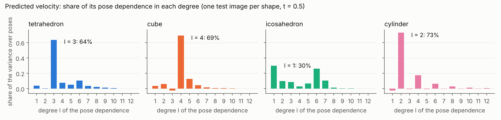
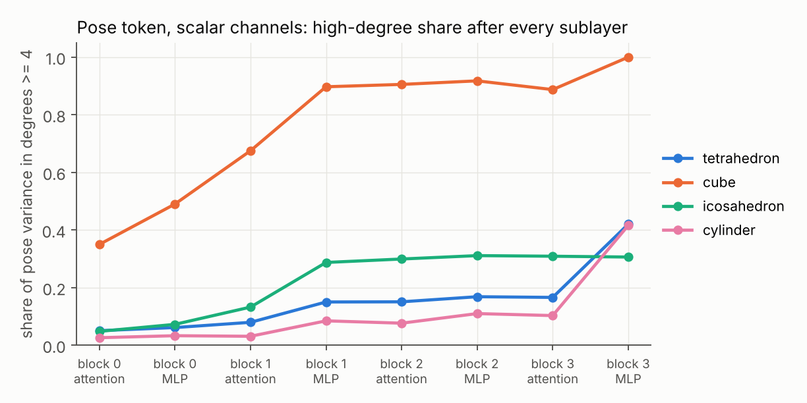
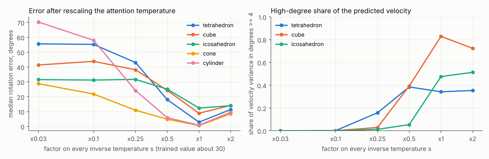

# How the cosine-attention GATr reaches high rotation degrees on SYMSOL

Mechanistic study, 2026-11-15, of one checkpoint: `symsol1_10pct_gatr_spherecloud_cosdir_h8_coslr_adamw_l4x4`
(Kaggle notebook `arynabiaroza/symsol-gatr-spherecloud-cosdir-h8`; SYMSOL I, 10 % of the training views, 40 epochs;
final log-likelihood 5.84, tetrahedron 7.38, cube 5.22, icosahedron 3.75). Scripts and raw numbers:
`probes/cosdir_interp/`. Everything was run on CPU on 12 to 24 test images per shape.

## The model, and the words used below

* **Flow model.** The network predicts an angular velocity `w(R, t, image)` that moves a pose `R` (a 3D rotation)
  from noise (flow time `t = 0`) to the object's pose (`t = 1`).
* **Tokens.** One GATr (Geometric Algebra Transformer, 4 blocks, 8 heads, 8 multivector and 32 scalar channels)
  runs over 90 tokens. Token 0, the **pose token**, holds the pose as its three axes `R e1, R e2, R e3` (`R e1` as
  an axial bivector, the other two as ordinary vectors). Tokens 1 to 89, the **cloud tokens**, are 88 fixed
  directions `x_j` on the camera-facing hemisphere (a HEALPix grid, about 15 degrees apart) plus the optical axis;
  each carries 64 scalar image features from a ResNet-50. The velocity is read from the pose token.
* **Cosine-direction attention** (`cosdir`, class `ScaledAttention` in the run's `models/cos_attention.py`, not yet
  in this repository). GATr's attention logit between query token `i` and key token `j` is replaced by
  `s_h * cos(q_i, k_j) + (scalar and distance terms)`, where `q_i`, `k_j` are the vector and bivector parts of the
  query and key, `cos` is the cosine of the angle between them, and `s_h` is one learnable inverse temperature per
  head `h` and block, started at 30.
* **Degree `l`.** A function of the pose `R` splits into parts that transform under the Wigner-D matrices of degree
  `l = 0, 1, 2, ...` (the Fourier series on the rotation group). Degree 0 is constant in `R`, degree 1 is linear in
  the entries of `R`, higher degrees vary faster. `P_l` is the share of a signal's variance over poses that sits in
  degree `l`. The symmetric velocity field of a tetrahedron has nothing between degrees 0 and 3, a cube nothing below
  4, an icosahedron nothing below 6 (`reports/frequency_hypothesis_ru.md`).
* **How `P_l` is measured** (`probes/cosdir_interp/probe.py`). The pose is turned along 128 random great circles of
  the rotation group, 128 points each; every intermediate activation is Fourier-transformed along the circle. A
  degree-`l` function spreads its power evenly over the frequencies `-l..l`, so with `E_m` the mean power at
  frequencies `+m` and `-m`, `P_l = (2l + 1)(E_l - E_{l+1}) / 2`. Checked on synthetic Wigner-D functions of degree
  1, 3 and 6. Differences of neighbouring frequencies are noisy: single `P_l` values are good to a few percent,
  and small negative values are noise.

## Findings

### 1. The output has the right degrees

For one test image per shape at `t = 0.5`, the predicted velocity has 64 % of its pose variance at degree 3 for the
tetrahedron and 69 % at degree 4 for the cube: the lowest degree each symmetry allows. The cylinder has only even
degrees (73 % at 2, 18 % at 4), as its symmetry requires. The icosahedron is only partly right: 26 % at degree 6,
but 30 % at degree 1 and 10 % at degree 2, which a perfectly symmetric field cannot have. That matches it being the
worst shape (12 degrees median error here, log-likelihood 3.75). Nothing measurable sits above degree 12.

### 2. Each attention head of the pose token is a narrow window at a direction fixed in the object's frame

For the pose token as query, the angular logit toward cloud token `j` is, to a fit quality R² of 1.00 in block 0
and 0.97 to 0.99 in blocks 1 and 2 (0.69 to 0.99 in block 3),

    logit_hj(R) = kappa_h * < R c_h , x_j >,

where `c_h` is a unit direction fixed in the object's own frame (one per head and block) and `kappa_h` a
concentration. So after the softmax each head is a von Mises-Fisher window (the Gaussian of the sphere) centred at
`R c_h`: the pose token reads the image features around the point where its own body direction `c_h` pierces the
sphere.

* `kappa_h` is 7 to 17 in block 0 and up to 25 in blocks 1 and 2, below `s_h` (about 30) because part of the
  unit-length query is taken by blades that do not meet the key. That is a window about 12 to 22 degrees wide,
  the spacing of the 88 grid points. A head typically spreads its weight over 5 to 14 of the 89 cloud tokens.
* The angular term dominates the logits: its spread over keys is 3.5 to 12, the scalar (content) term's is below
  1.7, the distance term's is 0 in blocks 0 to 2. The attention decides *where to look*, almost not *what to look
  for*.
* All probe directions `c_h`, in all four blocks, have zero component along the body's `e1` axis: the pose token
  only looks along the great circle of its `e2`-`e3` plane. The reason is parity. `R e1` enters as an axial
  bivector and the keys `x_j` are ordinary vectors; a reflection-equivariant network cannot turn one into the other.
* `c_h` barely depends on the image (cosine between images 0.94 to 1.00, except two heads of block 3), and the
  learned `s_h` stayed between 24.7 and 33.8. The window width is therefore set by the chosen start value 30, not
  found by training.

### 3. Where the degree comes from

A window of concentration `kappa` passes degree `l` of the signal it reads with amplitude
`a_l = i_l(kappa) / i_0(kappa)` (`i_l`: modified spherical Bessel function of the first kind):

| kappa | l = 2 | l = 3 | l = 4 | l = 6 | l = 8 | l = 10 |
|---|---|---|---|---|---|---|
| 1 (dot-product logits of spread about 1) | 0.06 | 0.01 | 0.00 | 0.00 | 0.00 | 0.00 |
| 10 | 0.73 | 0.54 | 0.36 | 0.12 | 0.03 | 0.01 |
| 25 | 0.89 | 0.78 | 0.67 | 0.43 | 0.23 | 0.11 |

Because the image features on the sphere turn with the object, reading them at `R c_h` gives a function of the
pose whose degree-`l` content is the degree-`l` content of the feature map, times `a_l`. The feature map of a
symmetric object has the object's symmetry, so the lowest degree that survives is already the right one. The
measurement agrees: after the first attention sublayer alone, the pose token's scalar channels have 35 % of their
pose variance at degree 4 or above for the cube, 44 % at degree 3 or above for the tetrahedron, and for the
cylinder 77 % at degree 2 or above but only 6 % at degree 3 or above.

Later sublayers raise the share further, and the MLP sublayers (geometric products and a gated GELU on one token)
add as much as the attention sublayers: they multiply values read through different windows, and degrees add
under multiplication. The icosahedron needs degree 6, where a window of `kappa` = 10 passes only 12 % of the
amplitude and the 88-point grid is close to its own resolution limit; its degree-6 share stays near 0.2 to 0.3.

The multivector channels of the pose token stay dominated by the degree-1 pose axes until block 2. No hidden
feature of degree 2 or more exists anywhere: every channel is still a scalar or a vector type. The high degrees
live in *how scalars and coefficients depend on the pose*.

### 4. Causal checks

* **Rescaling every `s_h` at inference** (no retraining; 12 images per shape, 2 samples each). At a quarter of the
  trained value the share of the velocity at degree 4 or above falls from 0.83 to 0.03 (cube) and from 0.48 to
  0.01 (icosahedron); at a tenth it is 0 for all shapes and every shape fails (tetrahedron 2.9 to 55 degrees).
  Doubling `s_h` also hurts (2.9 to 11 degrees), so part of the damage is plain mismatch with training; the
  collapse of the spectrum is the informative part.
* **One block at a time** (`s_h` times 0.1): every block matters; block 0 hurts most (tetrahedron 35 degrees,
  cone 25 degrees), blocks 1 to 3 hurt the polyhedra (16 to 28 degrees) far more than cone and cylinder (5 to 14).
* **Untrained network**, same image tokens, two seeds. With cosine attention at `s` = 30, 14 to 15 % of the first
  attention update's scalar variance is at degree 4 or above. With cosine attention at `s` = 1, or with GATr's own
  dot-product attention, it is 0.0 %. The high degrees are available before any training.

## What this means for the hypothesis

The hypothesis was that a learned high-dimensional space appears in which irreducible representations emerge.
The evidence supports a different picture:

1. **Nothing high-dimensional is learned or stored.** The hidden state keeps only scalars and vectors. The model
   works in *position space* on the sphere: narrow windows at body-fixed directions. A narrow window is a sum of
   all degrees up to about `kappa`, which is the same information a spherical-harmonics model keeps as
   coefficients.
2. **The bandwidth is an inductive bias, not a discovery.** It is set by the start value `s` = 30, which training
   left almost untouched. This is the role of `L` in NeRF's positional encoding or `lmax` in a harmonics model,
   moved from the input features into the attention kernel. What is learned is where the windows point (`c_h`),
   what the image features are, and how the read values are combined.
3. **The symmetry-specific degrees come from the image features**, which the ResNet and the lift to the sphere make
   symmetric like the object; the attention only has to be sharp enough to pass them.

## Limits

* One checkpoint, one seed, final epoch only. There is no dot-product checkpoint trained under the same recipe, so
  the comparison with plain GATr rests on the untrained networks and on the temperature rescaling.
* Spectra are from one image per shape (two flow times for the tetrahedron agree in shape); the cone image was
  missing from the downloaded subset for the spectrum run.
* Errors under intervention use 12 images per shape and 2 samples, so they are good to a few degrees.
* The window fit is for the pose token as query. Cloud tokens also attend to the pose token (up to 28 % of a
  head's weight) and their features become pose dependent; that path was measured but not dissected.

## Next experiments

* Train with `s` started at 3, 10 and 100, and with `s` frozen: does the degree the model reaches follow `s`?
* Give the pose token an ordinary-vector copy of `R e1`, so the windows can leave the `e2`-`e3` plane.
* A denser sphere grid (HEALPix nside 8, 352 points) with larger `s` for the icosahedron.
* The same probes on checkpoints saved during training.
