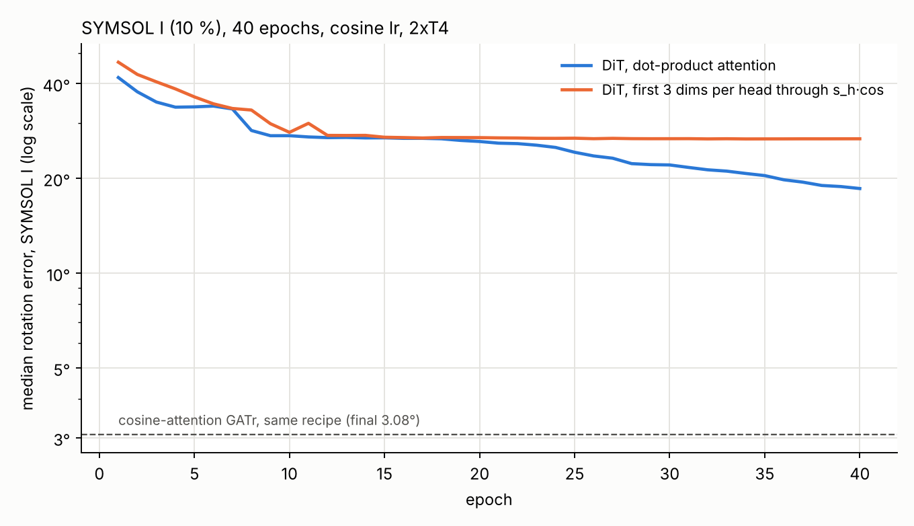

# DiT with a scaled-cosine vector part on SYMSOL I

Question (2026-11-21, from a human): does a DiT gain from the cosine-attention GATr's mechanism if the first 3 dimensions of
every attention head use a scaled cosine and the rest the usual dot product?

**Model.** `--dit_cos_vector` (`models/dit_flow.CosVectorAttention`, tests in `tests/test_dit_cosvec.py`): in the vector
field's attention, per head h the logit between tokens i and j is

  s_h * cos(q_i[:3], k_j[:3]) + q_i[3:] . k_j[3:] / sqrt(d_head - 3),

where q and k are the head's query and key vectors, [:3] their first 3 dimensions and [3:] the rest, d_head = 14 (width
112 / 8 heads), and s_h > 0 is a learnable inverse temperature per head and block (stored as log s_h, starting at 30,
capped at 100, as in the GATr). The condition head is unchanged.

**Runs** (`notebooks/make_dit_cosvec_runner.py`, account saudic, 2xT4, about 300 s per epoch): the recipe of
`arynabiaroza/symsol-gatr-spherecloud-cosdir-h8` (cosine GATr, final median 3.08 degrees): SYMSOL I, 4,500 training and
5,000 test views per shape, 40 epochs, cosine learning-rate schedule, AdamW 1e-4 sqrt-scaled, batch 64, no EMA, seed 0;
DiT width 112, 4 blocks, 8 heads, condition tokens from the 88 hemisphere points (`--dit_sphere_tokens`). The two runs
differ only in the attention (vector field 990,867 vs 990,899 parameters: the 32 values of s_h).

| final evaluation (32 samples) | median | class-mean median | acc@15 | acc@30 | tet | cube | icosa | cone | cyl |
|---|---|---|---|---|---|---|---|---|---|
| `saudic/symsol1-dit-sphere-h8-coslr-plain-t4x2` (dot product) | 19.36 | 20.37 | 0.460 | 0.641 | 31.07 | 38.49 | 30.90 | 0.60 | 0.82 |
| `saudic/symsol1-dit-sphere-h8-coslr-cosvec-t4x2` (cosine vector part) | 26.77 | 25.85 | 0.412 | 0.542 | 53.87 | 42.37 | 30.80 | 0.97 | 1.24 |
| cosine GATr, same recipe (4xL4) | 3.08 | | 0.766 | | 3.17 | 16.52 | 13.79 | 0.69 | 1.12 |

* **The cosine vector part makes the DiT worse**, not better: 26.8 against 19.4 degrees median; tetrahedron 53.9
  against 31.1. Its per-epoch error stops falling at about epoch 20 (26.7 degrees from there to epoch 40), while the
  plain DiT is still improving at epoch 40 (18.6).
* Both DiTs solve the cone and cylinder (under 1.3 degrees) and fail the three polyhedra; the GATr solves the
  tetrahedron (3.2 degrees) in the same 40 epochs.
* **The learned s_h fall** from 30 to 21 to 27 (median about 24): the heads widen their windows instead of sharpening them.
* Plausible reason, not tested: in the GATr the cosine acts on the vector and bivector parts of multivectors, which turn
  with the object (equivariant features), so a window of fixed width picks out a fixed direction in the object's frame.
  In the DiT the three dimensions are ordinary learned features with no geometric meaning, and the sharp cosine only
  makes the attention more selective in an arbitrary 3-dimensional subspace; at s_h near 30 a head attends almost
  one-hot, which can hinder learning in a model without that structure.
* One seed per arm and 40 epochs; the plain DiT had not converged.
