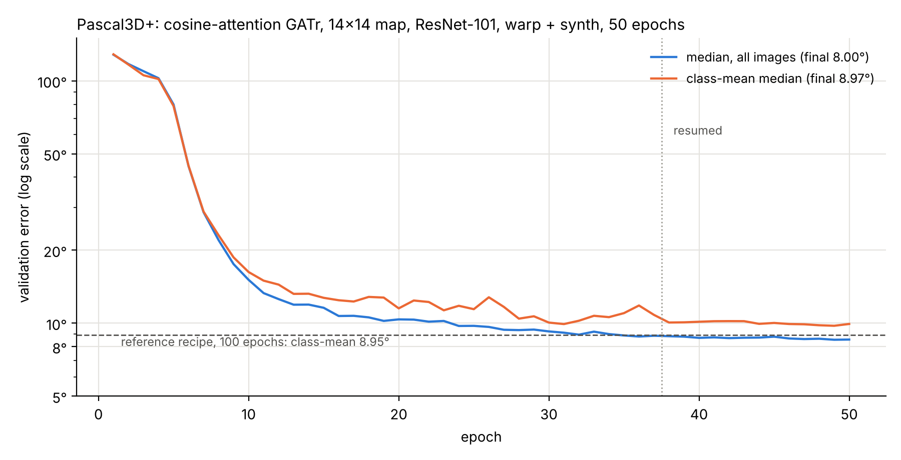

# The cosine-attention GATr with the 14x14 feature map on Pascal3D+

Run 2026-11-23/24, requested by a human. Runner: `notebooks/make_pascal_cosdir_runner.py`; numbers:
`probes/cosdir_interp/results/pascal_cosdir_e50.json`; figure script: `probes/cosdir_interp/plot_pascal_cosdir.py`.

## What was run

* **Model**: the cosine-attention GATr of `reports/cosdir_mechanism.md`, in the form that learned the bottom-view
  pyramids (`reports/cosdir_bottom_view.md`). The ResNet's last stage is dilated, so the image tokens are lifted from a
  14x14 feature map instead of 7x7 (`--dircloud_grid 14`). They sit on 368 hemisphere points (`--dircloud_nside 8`).
  Each attention head scores a query and a key by s_h * cos(angle between their directions), where s_h is a learnable
  inverse temperature per head that starts at 60.
* **Data and training**: the repository's Pascal3D+ reference recipe (`config.py` defaults):
  * backbone ResNet-101;
  * 18,371 real training images with warp augmentation, plus 3 synthetic renders per real image (73,484 samples per
    epoch);
  * EMA weights, global batch 64, AdamW 1e-4 with sqrt scaling, 5 warm-up epochs;
  * **50 epochs instead of the reference's 100.**
* **Hardware**: 4xL4, reached through the Gemma 4 competition and billed at 2x quota. Two Kaggle sessions: epochs
  1-37 on syfry5suvzovvakmuj, then epochs 38-50 on grig0ryz, resumed from the per-epoch checkpoint. 0.91 s per step,
  1,080 s per epoch, plus about 17 min of setup per session (12 min to read the synthetic pack, 5 min of annotations).
* **Evaluation**: 32 samples per image with the medoid (the repository's standard), on the 1,309 validation images.
  "Class-mean" is the mean of the 12 per-class median errors, the number Pascal3D+ papers report.

## Result

| model | epochs | median, all images | class-mean median | acc@15 | acc@30 |
|---|---|---|---|---|---|
| **cosine GATr, 14x14 map (this run)** | 50 | **8.00** | **8.97** | 0.743 | 0.891 |
| reference recipe (plain GATr head), `reports/flash_clifford/frameworks.md` | 100 | 7.85 | 8.95 | 0.743 | 0.886 |
| dircloud GATr P1, `reports/equivariance_gap_experiments.md` | | | 9.35 | | |
| Image2Sphere (literature, ResNet-101) | | | 9.8 | | |

Class-mean acc@15 / acc@30: 0.721 / 0.884. Per-class median error (degrees):

| aeroplane | bicycle | boat | bottle | bus | car | chair | diningtable | motorbike | sofa | train | tvmonitor |
|---|---|---|---|---|---|---|---|---|---|---|---|
| 8.27 | 11.59 | 16.44 | 7.76 | 2.96 | 4.23 | 9.99 | 6.32 | 11.17 | 12.59 | 6.09 | 10.30 |

The per-epoch curve is the trainer's quicker validation, so it sits above the final 32-sample numbers (last epoch
about 9.9 class-mean against 8.97 final).

**Reading.** In half the epochs the cosine GATr with the larger map matches the reference recipe's class-mean
(8.97 vs 8.95). It is better than the closest relative in the repository, the dircloud GATr P1 (9.35), and better than
Image2Sphere (9.8). This is one seed: re-evaluating the same weights moves the class-mean by about 0.17 deg, and seeds
of the reference spread from 8.93 to 9.12 deg. So the run is level with the reference, not better. Whether 100 epochs
would go below 8.95 is not known.

## What it took (four fixes, all in the runner)

1. **A 12-minute hang before training.** Image2Sphere's `get_pascal_paths` calls `os.path.exists` for every image in
   the VOC lists. That is tens of thousands of calls, slow on Kaggle's lazily mounted dataset, and every DDP rank made
   them. The stack dumps of a diagnostic kernel showed it. It is replaced by one directory listing per category, with
   the same result.
2. **CUDA out of memory on a T4** in the first backward pass (ResNet-101 + 14x14 map + 368 tokens). Fixed with GATr's
   block checkpointing, as for the 28x28 SYMSOL runs.
3. **A crash after epoch 1 on 4xL4.** `engine/distributed.sync_buffers` broadcast a buffer that lives on the CPU, which
   NCCL cannot send. Only the CUDA buffers (BatchNorm statistics) are broadcast now; the CPU ones are constants built
   identically on every rank.
4. **Resume**: the saved CPU RNG state is loaded onto the GPU and refused by `torch.set_rng_state`. It is moved back to
   the CPU, the same fix as for the 28x28 resumes.

Also: the synthetic pack is read into RAM by every DDP rank (about 18 GB each). Two ranks do not fit a 2xT4 machine,
which has about 29 GB, so the full recipe needs a machine with more RAM (4xL4 here) or a single GPU. On 2xT4 with real
images only, the model runs at 3.0 s per step.

## Cost

About 17 h of wall-clock over the two sessions, about 35 quota-hours at the 2x rate. On top of that come the timing and
diagnostic kernels: about 2 h on 2xT4 and 0.5 h on 4xL4.
