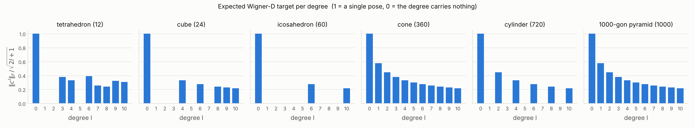
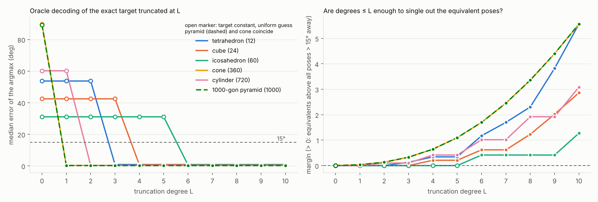

# Which irreps a symmetric shape's pose density needs

Code: [`probes/symmetry_spectrum/symmetry_spectrum.py`](../probes/symmetry_spectrum/symmetry_spectrum.py) (invariant
counts, CPU, about 30 s) and [`symmetry_decoding.py`](../probes/symmetry_spectrum/symmetry_decoding.py) (expected Wigner-D
target and its truncated decoding, CPU, about 10 min). Figures and the raw numbers:
[`figures/symmetry_spectrum/`](figures/symmetry_spectrum/).

This rewrites the diagnostic that `frequency_hypothesis_ru.md` §3.2 cites as `~/rfeval/symsol/analysis_*.py`. That
script was never committed. The result is the same: the lowest nonzero degree is 3 / 4 / 6 / 1 / 2 for tetrahedron /
cube / icosahedron / cone / cylinder. It also adds a 1000-gonal pyramid and answers the general question.

## Setup

Symbols:

* `G` is the shape's rotation symmetry group: the rotations `g` with `shape = g · shape`. `|G|` is its number of elements.
* `R0` is the pose of one view. The equivalent poses (SYMSOL's labels) are `R0 g` for `g` in `G`.
* `D^l(R)` is the real Wigner matrix of degree `l` (size `(2l+1) x (2l+1)`, e3nn's convention), the degree-`l`
  irreducible representation (irrep) of SO(3).
* `p(R) = (1/|G|) Σ_g δ(R, R0 g)` is the ideal pose density of the view: equal point masses on the equivalent poses.

The degree-`l` Fourier block of `p` is

```
c^l = (1/|G|) Σ_g D^l(R0 g) = D^l(R0) P^l,        P^l = (1/|G|) Σ_g D^l(g).
```

`P^l` is the orthogonal projector onto the vectors of the degree-`l` irrep that `G` leaves fixed. It does not depend on
the view: the view only rotates the block. So for every image, the block `c^l` is zero exactly when `P^l = 0`. Otherwise
its rank is `n_l = rank P^l`, the number of degree-`l` invariants of `G`. The script computes `n_l` in two ways and
asserts that they agree:

1. **From Wigner matrices.** `P^l` is averaged over the group elements with `models/so3fourier_head.wigner_blocks`, for
   `l ≤ 12`. Each `P^l` is checked to be a projector, with error below `1.2e-15`.
2. **From characters.** `n_l = (1/|G|) Σ_g χ_l(θ_g)`, where `θ_g` is the rotation angle of `g` and
   `χ_l(θ) = 1 + 2 Σ_{m=1..l} cos(mθ)` is the trace of `D^l`. This is exact and cheap for any `l`; it is used up to
   `l = 2200`.

The groups for the SYMSOL shapes come from `datasets/symsol_points.py`. As in SYMSOL's own label files, the cone and the
cylinder are discretised at 1°: the cone is `C_360` (the 360 turns about its axis) and the cylinder is `D_360` (the
same 360 turns, each also flipped end over end, 720 elements). The new shape is a regular 1000-gonal pyramid. Its
apex is on `e3`, so its group is the cyclic group `C_1000` (turns by `2πk/1000`), with no flip.

## Result: SYMSOL shapes and the pyramid


**How the heatmap is made.** Row = shape, column = degree `l`. The cell value is
`n_l = rank P^l = (1/|G|) Σ_g χ_l(θ_g)`, the number of independent nonzero directions in the degree-`l` block of the
density. `·` marks `n_l = 0`, a block that is zero for every view. The colour encodes the same number.

| shape | `G` | `\|G\|` | lowest `l > 0` with a nonzero block | `n_l`, `l = 0..12` |
|---|---|---|---|---|
| tetrahedron | T | 12 | **3** | 1 0 0 1 1 0 2 1 1 2 2 1 3 |
| cube | O | 24 | **4** | 1 0 0 0 1 0 1 0 1 1 1 0 2 |
| icosahedron | I | 60 | **6** | 1 0 0 0 0 0 1 0 0 0 1 0 1 |
| cone (SYMSOL labels) | C_360 | 360 | **1** | 1 1 1 1 1 1 1 1 1 1 1 1 1 |
| cylinder (SYMSOL labels) | D_360 | 720 | **2** | 1 0 1 0 1 0 1 0 1 0 1 0 1 |
| 1000-gonal pyramid | C_1000 | 1000 | **1** | 1 1 1 1 1 1 1 1 1 1 1 1 1 |

The polyhedra's rows are the classical invariant counts of T, O and I. A head truncated at `lmax = 6`, such as
Image2Sphere's on SYMSOL, sees a single icosahedral invariant, at `l = 6`.

For `l < 1000` the pyramid's row is exactly the cone's. `C_n` leaves fixed only the components with order `m ≡ 0 mod n`
about the axis. Below `l = n` that is only `m = 0`, which is also the single invariant of the continuous cone, SO(2).
Since `P^l` is identical for every `l < 1000`, the pose density of the 1000-gonal pyramid, truncated at any
`lmax < 1000`, *is* the density of a cone. The first difference is at `l = 1000`, where the components `m = ±1000` become
invariant and `n_l` jumps from 1 to 3:


**How this plot is made.** The same `n_l`, from characters, for `l = 0..2200`. For the cyclic group `C_n` it has a
closed form: `D^l` restricted to turns about the axis is diagonal in the order `m = −l..l`, with entries `e^{imφ}`. A
component is invariant iff `m` is a multiple of `n`, so `n_l = 2⌊l/n⌋ + 1`. The ideal cone, SO(2), keeps only `m = 0`,
so `n_l = 1`. The vertical lines mark `l = 360` and `l = 1000`.

The same plot shows a detail of SYMSOL itself. Its cone labels (1° steps, `C_360`) differ from a true cone from
`l = 360` on. This has no effect on any model in this repository, which all stop at `lmax ≤ 6`.

## The expected Wigner-D target and what its truncation decodes

These are the two plots of the earlier, uncommitted analysis, recomputed (`symmetry_decoding.py`).

**Where the target comes from.** The Wigner-D regressor (`models/wignerd.py`, Lee & Cho 2024) outputs coefficients
`Ψ^l`, one `(2l+1) x (2l+1)` block per degree, and is trained with `Σ_l w_l |Ψ^l - D^l(R_label)|^2`. On a symmetric
shape the label `R_label` is a uniformly drawn equivalent `R0 g`. The MSE is minimised by the mean of the labels, so
the best possible output, the *expected Wigner-D target*, is

```
c^l = E_g[D^l(R0 g)] = (1/|G|) Σ_g D^l(R0 g) = D^l(R0) P^l,
```

which is the same `c^l` as above. The model decodes like `wignerd.predict`: the grid rotation with the highest score

```
f_L(R) = Σ_{l ≤ L} <c^l, D^l(R)>,          <A, B> = Σ_ij A_ij B_ij,
```

where `L` is the truncation degree (the model's `lmax`). Every degree is weighted 1, as in the model.

Further symbols for the figures:

* `V = 50` random views `R0` per shape.
* The grid: 294,912 super-Fibonacci rotations (Alexa 2022, near-uniform). That is the size of Image2Sphere's HEALPix
  level 4, about 3.7° spacing.
* `d(R, R0 G) = min_g d(R, R0 g)` is the geodesic angle from `R` to the nearest equivalent pose.

**Figure: target size per degree.** The bar height is `|c^l|_F / |D^l(R0)|_F`. Since `D^l` is orthogonal,
`|D^l|_F = sqrt(2l+1)`. Since `P^l` is a projector of rank `n_l`, `|c^l|_F = |P^l|_F = sqrt(n_l)`. So the bar is
`sqrt(n_l / (2l+1))`: 1 when the degree pins the pose down completely (a single pose, `G = {1}`) and 0 when the degree
carries nothing. It shows the same zeros as the heatmap, normalised by the block size. The script asserts that the
measured norm equals `sqrt(n_l / (2l+1))`.



**Figure, left: oracle decoding.** `R̂_L = argmax over the grid of f_L`, and the plotted value is the median over views
of `d(R̂_L, R0 G)` in degrees. "Oracle" means the model output is exactly the target. This isolates what truncation at `L`
costs, with no learning error. When `n_l = 0` for every `1 ≤ l ≤ L`, `f_L` is the constant `n_0 = 1`. Every grid rotation
then ties and the argmax is arbitrary, so the plot shows the median error of a uniformly random rotation (open markers).
The dashed line is 15°.

**Figure, right: margin.** For a degree-`L` score to rank the poses correctly, every equivalent pose has to score above
every wrong pose:

```
margin_L = min_g f_L(R0 g) − max { f_L(R) : R on the grid, d(R, R0 G) > 15° }.
```

A positive margin means the degrees `≤ L` single out the equivalent poses. The first term is exact and the same for every
view: `<D^l(R0) P^l, D^l(R0 g)> = tr(P^l D^l(g)) = tr P^l = n_l` (because `P^l D^l(g) = P^l`). So
`min_g f_L(R0 g) = Σ_{l ≤ L} n_l`. When `f_L` is constant the margin is 0 (open markers). Median over views.



**Result** (50 views per shape; numbers in `figures/symmetry_spectrum/truncated_decoding.json`):

| shape | first `L` with a non-constant target | median error at that `L` | margin at that `L` | margin at `L = 10` |
|---|---|---|---|---|
| tetrahedron | 3 | 0.9° | 0.131 | 5.57 |
| cube | 4 | 0.7° | 0.209 | 2.86 |
| icosahedron | 6 | 0.6° | 0.415 | 1.27 |
| cone | 1 | 0.3° | 0.034 | 5.56 |
| cylinder | 2 | 0.3° | 0.100 | 3.09 |
| 1000-gonal pyramid | 1 | 0.2° | 0.034 | 5.57 |

* **No partial credit.** Decoding fails completely below the lowest nonzero degree of the shape and succeeds completely
  from it on. With the first informative degree the argmax already lands on an equivalent pose, to within the grid's
  resolution (the sub-degree plateau is grid-limited). The margin is positive at that `L`, so the equivalent poses
  are the strict top of the score.
* **Below that degree the target is exactly constant.** Its error is a uniform guess: 53.7° / 42.4° / 31.1° / 89.8° /
  60.2° for tet / cube / icosa / cone / cylinder, the median distance from a random rotation to the nearest equivalent.
  The margin is exactly 0.
* **The margin grows in steps** at the degrees with `n_l > 0`: each such degree adds `n_l` at the equivalent poses and
  sharpens the peaks. For the icosahedron it stays at 0.415 from `L = 6` to 9, because degrees 7–9 are zero.
* **Comparison with the old plot.** The old values match where it can be checked: the cone's 0.034 at `L = 1`
  (`= 2 − (1 + cos 15°)`), and 0.13 / 0.21 / 0.10 / 0.42 for tet / cube / cylinder / icosa at their first degree.
  Two parts of the old plot differ:
  * **Margin at large `L`.** The old margins grow more slowly with `L`. This is consistent with the old script
    reading the equivalents' score off a coarse grid rather than exactly: high-`L` peaks are sharp, and a grid point
    near a peak scores below the peak.
  * **Below the first degree.** The old plot has nonzero values there (margins near −2, errors that change with `L`),
    but the exact target is constant there, so those values were not computed from the exact target. Its script is
    not in the repository, so neither explanation can be checked.

## What it takes to learn the 1000-gonal pyramid

The pyramid needs the degree-1000 irrep to have its symmetry learned exactly, and only `l = 1` to have its pose
estimated well. These are different requirements.

* **Below `l = 1000` it is exactly a cone.** `C_1000` leaves fixed only the components of order `m ≡ 0 (mod 1000)` about
  its axis. For `l < 1000` that is `m = 0` alone, the same as the continuous cone, so `P^l(C_1000) = P^l(SO(2))`. The
  truncated target encodes the axis `R e3` (2 degrees of freedom) and leaves the turn φ about the axis uniform. Adding
  more degrees below 1000 changes nothing.
* **The 1000-fold structure lives in `D^1000`.** It sits in that irrep's components `m = ±1000` (`cos 1000φ`,
  `sin 1000φ`); `D^1000` has dimension 2001. An n-fold axis needs `l = n` in the same way, with or without the end-over-end
  flip.
* **Pose accuracy does not need it.** Equivalent poses are 0.36° apart, so a cone-like answer (axis right, turn
  arbitrary) is at most 0.18° from an equivalent. The table above shows the pyramid decoded to grid resolution from
  `L = 1`, like the cone. The 15° margin is blind to the turn for the same reason.
* **The density needs it.** Telling 1000 peaks from a uniform ring is what log-likelihood measures, and it needs
  `l ≥ 1000`. It only pays off when the model's peaks are narrower than about 0.36°: a peak of angular width `σ` needs
  degrees up to roughly `π / σ` anyway. A rendered 1000-gon at 224 px has sub-pixel facets, so for images the cone-like
  posterior is the correct one.
* **The `l = 1000` requirement is a property of linear readouts.** It binds a model whose output is linear in fixed
  irreps, such as Image2Sphere or the Wigner-D regressor (score `Σ_l <Ψ^l, D^l(R)>`). An equivariant network can reach
  high degrees nonlinearly, through tensor products of lower ones. A vector-only (geometric algebra) network would need
  a degree-1000 polynomial in its vectors, the obstacle of `ga_high_degree_irreps.md` at a far larger scale. A network
  that canonicalises the axis first turns the turn into a scalar angle φ, after which `cos 1000φ` is a
  frequency-1000 function of one variable: a spectral-bias problem, not a representation problem.

## The general case

Every finite rotation group is one of `C_n`, `D_n` (`C_n` plus `n` half-turns about axes perpendicular to the main
axis), T, O or I. There are two different questions, and they have different answers.

**1. Lowest degree at which the density is not uniform** (the smallest `l > 0` with `n_l > 0`). A model with no
higher-degree features cannot represent anything about the shape's symmetry below this degree.

| group | example | lowest `l` |
|---|---|---|
| `C_n`, SO(2) | pyramid, cone | 1 (the axis itself, `m = 0` of `l = 1`) |
| `D_n` (`n ≥ 2`), O(2) | prism, cylinder | 2 (the axis without its sign) |
| T | tetrahedron | 3 |
| O | cube | 4 |
| I | icosahedron | 6 |

This is bounded: **no shape needs more than `l = 6`** to have a non-uniform density. The icosahedron is the worst case.

**2. Lowest degree that tells the group apart from a larger one.** This is the degree needed to learn the symmetry
exactly rather than a coarser one. Two groups `G ⊂ G'` give the same density up to `lmax` iff `n_l(G) = n_l(G')` for
every `l ≤ lmax`. Checked with the script:

| pair | first `l` that separates them |
|---|---|
| `C_n` vs SO(2) | `n` (for `n = 2, 3, 5, 7, 12, 360, 1000`) |
| `D_n` vs O(2) | `n` (for `n = 2, 3, 5, 7, 12, 360`) |
| T vs O | 3 (`n_3(T) = 1`, `n_3(O) = 0`) |

This is **unbounded**. For axial shapes, the degree needed grows linearly with the order `n` of the axis. It is the
Nyquist limit on the circle of turns about the axis: `n` equally spaced modes are indistinguishable from a uniform circle
by any trigonometric polynomial of degree below `n`.

What the counts do *not* say: the ideal density is a sum of point masses, so all its degrees from the lowest one up are
nonzero, and a sharp peak of angular width `σ` needs degrees up to roughly `π / σ`. The table gives the degrees that
are *forced* to be zero by symmetry, not a degree after which the density is exactly represented.

## Caveats

* The density here is the ideal one, every equivalent pose with equal weight. The original diagnostic used the
  oracle flow velocity field `E[ξ | R_t]`. Its symmetry under `R -> R g` is the same and its lowest degrees matched
  (§3.2 of `frequency_hypothesis_ru.md`), but its full `n_l` table was not recomputed here.
* SYMSOL II (marked shapes) is not covered. There the density depends on whether the marker is visible, and a visible
  marker leaves a single pose, which has every degree.
* The pyramid exists only in this analysis. It is not a training shape: there are no renders, and
  `datasets/symsol_points.py` pads labels to 720 equivalents, fewer than its 1000.
