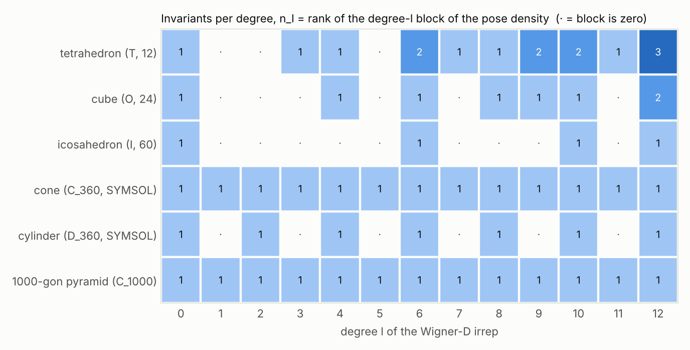
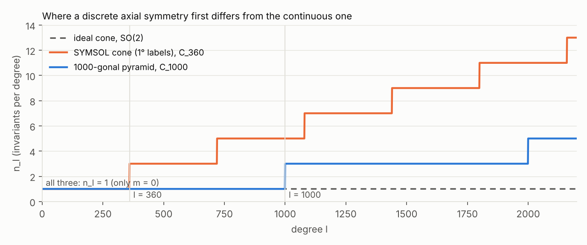

# Which irreps a symmetric shape's pose density needs

Code: [`probes/symmetry_spectrum/symmetry_spectrum.py`](../probes/symmetry_spectrum/symmetry_spectrum.py) (CPU, about 30 s).
Figures and the raw numbers: [`figures/symmetry_spectrum/`](figures/symmetry_spectrum/).

This rewrites the diagnostic that `frequency_hypothesis_ru.md` §3.2 cites as `~/rfeval/symsol/analysis_*.py`. That
script was never committed. The result is the same: the lowest nonzero degree is 3 / 4 / 6 / 1 / 2 for tetrahedron /
cube / icosahedron / cone / cylinder. It also adds a 1000-gonal pyramid and answers the general question.

## Setup

Symbols:

* `G` is the shape's rotation symmetry group: the rotations `g` with `shape = g · shape`. `|G|` is its number of elements.
* `R0` is the pose of one view. The equivalent poses (SYMSOL's labels) are `R0 g` for `g` in `G`.
* `D^l(R)` is the real Wigner matrix of degree `l` (size `(2l+1) x (2l+1)`, e3nn's convention), the degree-`l`
  irreducible representation (irrep) of SO(3).
* `p(R) = (1/|G|) Σ_g δ(R, R0 g)` is the ideal pose density of the view: equal point masses on the equivalent poses.

The degree-`l` Fourier block of `p` is

```
c^l = (1/|G|) Σ_g D^l(R0 g) = D^l(R0) P^l,        P^l = (1/|G|) Σ_g D^l(g).
```

`P^l` is the orthogonal projector onto the vectors of the degree-`l` irrep that `G` leaves fixed. It does not depend on
the view: the view only rotates the block. So for every image, the block `c^l` is zero exactly when `P^l = 0`. Otherwise
its rank is `n_l = rank P^l`, the number of degree-`l` invariants of `G`. The script computes `n_l` in two ways and
asserts that they agree:

1. **From Wigner matrices.** `P^l` is averaged over the group elements with `models/so3fourier_head.wigner_blocks`, for
   `l ≤ 12`. Each `P^l` is checked to be a projector, with error below `1.2e-15`.
2. **From characters.** `n_l = (1/|G|) Σ_g χ_l(θ_g)`, where `θ_g` is the rotation angle of `g` and
   `χ_l(θ) = 1 + 2 Σ_{m=1..l} cos(mθ)` is the trace of `D^l`. This is exact and cheap for any `l`; it is used up to
   `l = 2200`.

The groups for the SYMSOL shapes come from `datasets/symsol_points.py`. As in SYMSOL's own label files, the cone and the
cylinder are discretised at 1°: the cone is `C_360` (the 360 turns about its axis) and the cylinder is `D_360` (the
same 360 turns, each also flipped end over end, 720 elements). The new shape is a regular 1000-gonal pyramid. Its
apex is on `e3`, so its group is the cyclic group `C_1000` (turns by `2πk/1000`), with no flip.

## Result: SYMSOL shapes and the pyramid



| shape | `G` | `\|G\|` | lowest `l > 0` with a nonzero block | `n_l`, `l = 0..12` |
|---|---|---|---|---|
| tetrahedron | T | 12 | **3** | 1 0 0 1 1 0 2 1 1 2 2 1 3 |
| cube | O | 24 | **4** | 1 0 0 0 1 0 1 0 1 1 1 0 2 |
| icosahedron | I | 60 | **6** | 1 0 0 0 0 0 1 0 0 0 1 0 1 |
| cone (SYMSOL labels) | C_360 | 360 | **1** | 1 1 1 1 1 1 1 1 1 1 1 1 1 |
| cylinder (SYMSOL labels) | D_360 | 720 | **2** | 1 0 1 0 1 0 1 0 1 0 1 0 1 |
| 1000-gonal pyramid | C_1000 | 1000 | **1** | 1 1 1 1 1 1 1 1 1 1 1 1 1 |

The polyhedra's rows are the classical invariant counts of T, O and I. A head truncated at `lmax = 6`, such as
Image2Sphere's on SYMSOL, sees a single icosahedral invariant, at `l = 6`.

For `l < 1000` the pyramid's row is exactly the cone's. `C_n` leaves fixed only the components with order `m ≡ 0 mod n`
about the axis. Below `l = n` that is only `m = 0`, which is also the single invariant of the continuous cone, SO(2).
Since `P^l` is identical for every `l < 1000`, the pose density of the 1000-gonal pyramid, truncated at any
`lmax < 1000`, *is* the density of a cone. The first difference is at `l = 1000`, where the components `m = ±1000` become
invariant and `n_l` jumps from 1 to 3:



The same plot shows a detail of SYMSOL itself. Its cone labels (1° steps, `C_360`) differ from a true cone from
`l = 360` on. This has no effect on any model in this repository, which all stop at `lmax ≤ 6`.

## The general case

Every finite rotation group is one of `C_n`, `D_n` (`C_n` plus `n` half-turns about axes perpendicular to the main
axis), T, O or I. There are two different questions, and they have different answers.

**1. Lowest degree at which the density is not uniform** (the smallest `l > 0` with `n_l > 0`). A model with no
higher-degree features cannot represent anything about the shape's symmetry below this degree.

| group | example | lowest `l` |
|---|---|---|
| `C_n`, SO(2) | pyramid, cone | 1 (the axis itself, `m = 0` of `l = 1`) |
| `D_n` (`n ≥ 2`), O(2) | prism, cylinder | 2 (the axis without its sign) |
| T | tetrahedron | 3 |
| O | cube | 4 |
| I | icosahedron | 6 |

This is bounded: **no shape needs more than `l = 6`** to have a non-uniform density. The icosahedron is the worst case.

**2. Lowest degree that tells the group apart from a larger one.** This is the degree needed to learn the symmetry
exactly rather than a coarser one. Two groups `G ⊂ G'` give the same density up to `lmax` iff `n_l(G) = n_l(G')` for
every `l ≤ lmax`. Checked with the script:

| pair | first `l` that separates them |
|---|---|
| `C_n` vs SO(2) | `n` (for `n = 2, 3, 5, 7, 12, 360, 1000`) |
| `D_n` vs O(2) | `n` (for `n = 2, 3, 5, 7, 12, 360`) |
| T vs O | 3 (`n_3(T) = 1`, `n_3(O) = 0`) |

This is **unbounded**. For axial shapes, the degree needed grows linearly with the order `n` of the axis. It is the
Nyquist limit on the circle of turns about the axis: `n` equally spaced modes are indistinguishable from a uniform circle
by any trigonometric polynomial of degree below `n`.

What the counts do *not* say: the ideal density is a sum of point masses, so all its degrees from the lowest one up are
nonzero, and a sharp peak of angular width `σ` needs degrees up to roughly `π / σ`. The table gives the degrees that
are *forced* to be zero by symmetry, not a degree after which the density is exactly represented.

## Caveats

* The density here is the ideal one, every equivalent pose with equal weight. The original diagnostic used the
  oracle flow velocity field `E[ξ | R_t]`. Its symmetry under `R -> R g` is the same and its lowest degrees matched
  (§3.2 of `frequency_hypothesis_ru.md`), but its full `n_l` table was not recomputed here.
* SYMSOL II (marked shapes) is not covered. There the density depends on whether the marker is visible, and a visible
  marker leaves a single pose, which has every degree.
* The pyramid exists only in this analysis. It is not a training shape: there are no renders, and
  `datasets/symsol_points.py` pads labels to 720 equivalents, fewer than its 1000.
